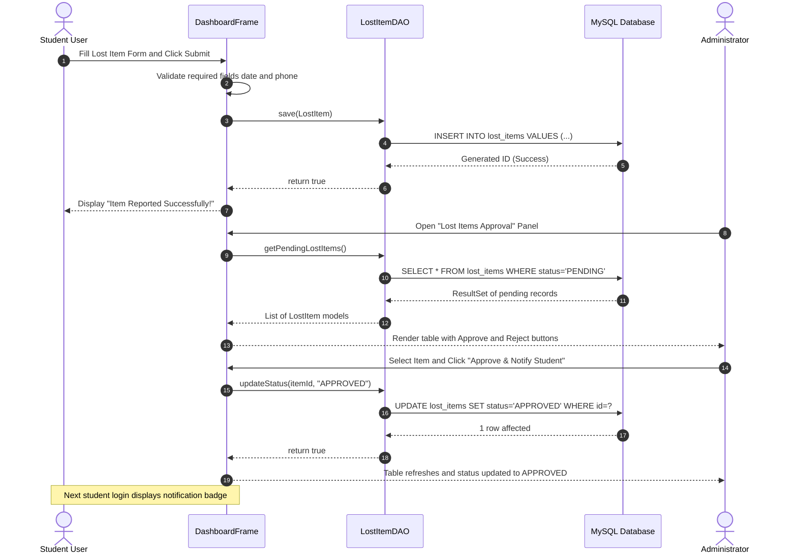
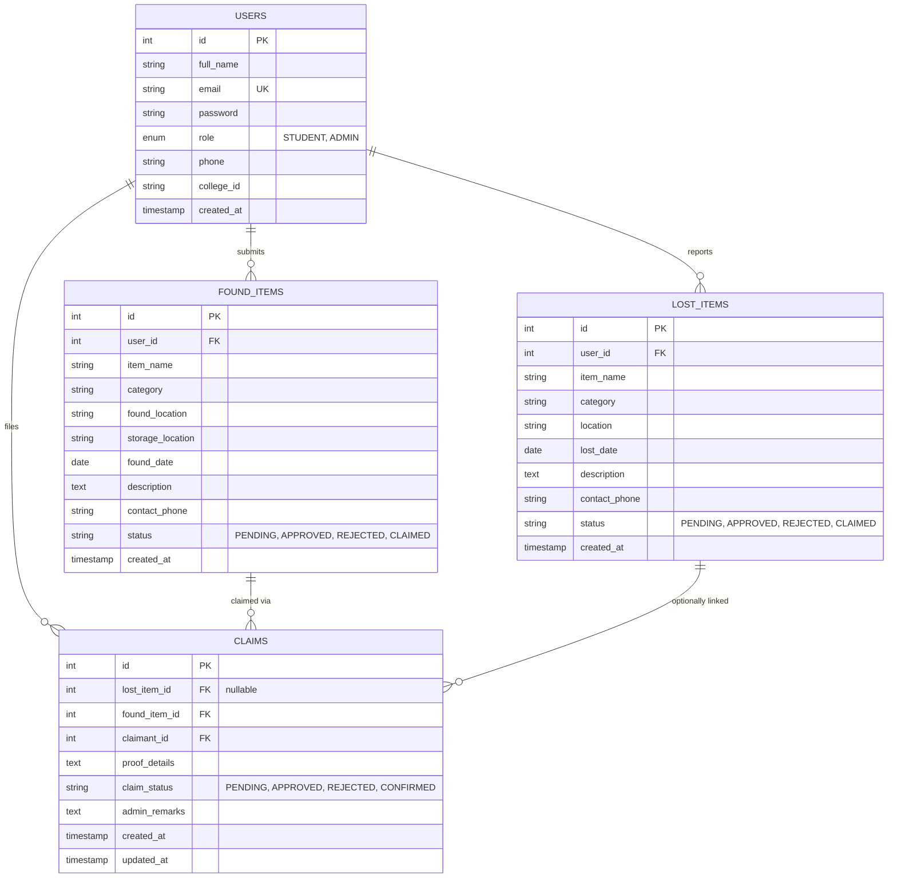
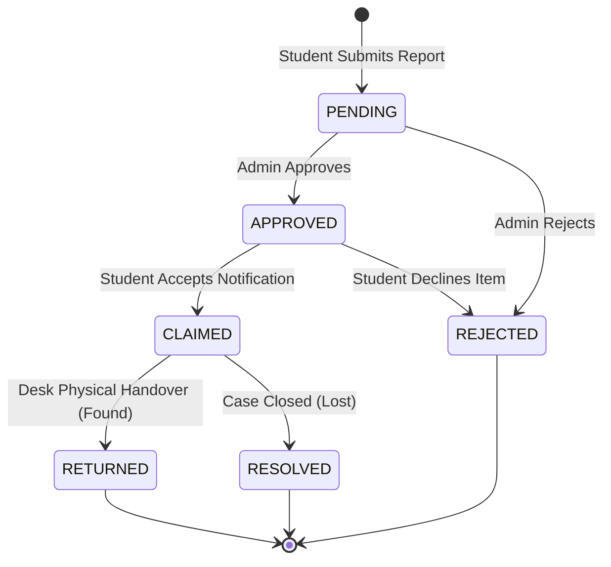

# Smart Lost & Found System
### Campus Property Recovery & Management System

[](https://www.oracle.com/java/)
[](https://docs.oracle.com/javase/tutorial/uiswing/)
[](https://www.mysql.com/)
[](https://dev.mysql.com/doc/connector-j/en/)
[](https://www.rtu.ac.in/)
[](LICENSE)

A stand-alone, high-performance desktop application engineered in **Core Java (JDK 17)** with **Java Swing** and **MySQL / Cloud Database** via **JDBC DAO Pattern**, designed to replace informal campus lost-and-found practices with centralized tracking, administrative approval lifecycle, and intelligent rule-based item matching.

---

## 🏛️ Project Administration

* **Institution:** Arya College of Engineering & Information Technology (ACEIT), Jaipur
* **Department:** Department of Artificial Intelligence & Data Science
* **Affiliation:** Rajasthan Technical University (RTU), Kota (Raj.)
* **Academic Session:** 2026–27 | B.Tech. AI & Data Science
* **Course:** Foundation Course (Tinkering & Elements of Design) / Java PBL Track
* **Project Guide & Mentor:** **Er. Ram Babu Buri**, Assistant Professor
* **Head of Department (HOD):** **Dr. Ashok Kajla**, Professor

### Team Members

| Name | Roll No. | Module |
| :--- | :--- | :--- |
| Mohit Kumar Sharma | 24EARAD103 | Database & DAO Layer |
| Prabhash Kumar Chaudhary | 24EARAD121 | Authentication & User Management |
| Mitesh Nehra | 24EARAD102 | Student Panel (UI + Logic) |
| Naitik Pathak | 24EARAD106 | Admin Panel (UI + Logic) |
| Paramveer Singh | 24EARAD119 | Testing, Integration & Documentation |

> **Saturday = Mentor Meeting (All members attend) | Sunday = Review / Self-Study**

---

### 📑 Project Deliverables & Technical Artifacts (Direct Access)

| Deliverable | Description | Resource Link |
| :--- | :--- | :--- |
| 📄 **Final Project Report** | Complete 36-Page Technical Architecture Document, System Requirements Specification (SRS), and Evaluation Metrics | [View Project Report](docs/PROJECT_REPORT.md) \| [ARCHITECTURE.md](docs/ARCHITECTURE.md) |
| 📊 **Presentation Deck (PPT)** | 16-Slide B.Tech Final Project Evaluation Deck covering System Design, Cloud DB, Matching Service & Testing | [View Presentation Deck (Slides)](docs/PROJECT_REPORT.md) |
| 🎥 **Video Demonstration** | 10-Minute HD Walkthrough of Smart Lost & Found System (Student Workflow, Matching Engine, Live Cloud DB & Admin Console) | [Watch Video Demonstration](docs/demo_video_link.md) |
| 📜 **Software Requirements (SRS)** | IEEE 830 / ISO 29148 Compliant Specification Document covering all 16 Functional & Non-Functional Requirements | [View SRS Document](docs/SRS.md) |
| 🔬 **Research Paper** | Complete Academic Research Paper on Campus Property Recovery & Rule-Based Matching Algorithms | [View Research Paper](docs/RESEARCH_PAPER.md) |


---

# 📅 12-Week Project Development Log (Week-by-Week)

---

## 🔹 Week 1: Team Formation, Topic Selection & Abstract
**Duration:** 6 July 2026 – 12 July 2026

### 1.1 Academic Abstract
Misplacing personal belongings such as student identity cards, laboratory manuals, electronic gadgets, backpacks, keys, and wallets is an enduring logistical challenge across university campuses. Conventional campus recovery practices rely on informal pinboards, word of mouth, and unstructured social media chat groups. These outdated channels suffer from acute information fragmentation, zero remote searchability, vulnerable ownership verification, and high administrative latency.

The **Smart Lost & Found System** resolves these deficiencies by introducing a centralized, secure desktop application engineered with **Core Java (JDK 17)**, **Java Swing**, and **MySQL relational persistence** via **JDBC** and the **Data Access Object (DAO)** pattern. The system implements strict **Role-Based Access Control (RBAC)** across two synchronized dashboards:
1. **Student Self-Service Panel:** Enables students to report lost articles, submit found belongings, track status changes in real-time, receive administrative approval alerts, and claim matching articles.
2. **Administrative Governance Console:** Empowers campus staff to verify incoming reports, register items received at the campus desk, approve/reject submissions, and maintain an audit log of claimed items.

Furthermore, the system incorporates a rule-based **Matching Service** that evaluates lexical keyword overlap and category equality between lost reports and recovered inventory. Packaged as a portable Windows desktop bundle with an embedded Java runtime and cloud database support, the application provides immediate responsiveness, zero SQL injection vulnerabilities via parameterized queries, and ACID-compliant transaction integrity.

### 1.2 Module Allocations & Deliverables
* Team registration completed on the academic project portal under **Er. Ram Babu Buri**.
* Initial Git repository initialized with Maven/Java directory layout.
* Initial high-level feature list and problem definition approved.

### 1.3 Week 1 Daily Activity Log

| Member | Mon (6 Jul) | Tue (7 Jul) | Wed (8 Jul) | Thu (9 Jul) | Fri (10 Jul) | Sat (11 Jul) | Sun (12 Jul) |
| :--- | :--- | :--- | :--- | :--- | :--- | :--- | :--- |
| **Mohit Kumar** | Registered team on portal, created GitHub repo & basic folders. | Listed required database entities and role workflows. | Researched online lost & found portals; finalized feature list. | Authored initial 250-word project abstract draft. | Revised abstract per team input; pushed first repository commit. | **Mentor Meeting:** Presented abstract to Er. Ram Babu Buri. | Reviewed mentor feedback; sketched table column requirements. |
| **Prabhash Kumar** | Joined repo; outlined auth, session, and role scopes. | Identified login distinction between Student and Admin. | Studied Swing password fields and dialog popups. | Wrote auth summary for abstract; drafted screen requirements. | Created placeholder `LoginFrame`, `RegisterFrame`, `User`. | **Mentor Meeting:** Attended; recorded login validation feedback. | Researched package structure conventions (`ui`, `model`, `dao`). |
| **Mitesh Nehra** | Joined repo; mapped Student Panel requirements and lifecycle. | Designed student journey: report, approval, notification, claim. | Researched Swing `CardLayout`, `JTable`, and `JScrollPane`. | Wrote student panel summary for abstract. | Created placeholder `StudentDashboard` and `LostItem`. | **Mentor Meeting:** Attended; clarified student workflow expectations. | Listed 5 student sections: Lost, Found, Reports, Alerts, Claims. |
| **Naitik Pathak** | Joined repo; outlined Admin Panel sections. | Documented admin capabilities: review, desk entry, claimed audit. | Studied `JTable` selection handling and action events. | Wrote admin summary for abstract; aligned with Mitesh. | Created placeholder `AdminDashboard` and `FoundItem`. | **Mentor Meeting:** Attended; received guidance on admin actions. | Drafted schema columns for 4 admin operational panels. |
| **Paramveer Singh** | Joined repo; drafted testing, doc, and submission roadmap. | Analyzed end-to-end workflows from both user perspectives. | Researched IEEE SRS standards and testing levels. | Wrote QA summary for abstract; created `docs/` and `test/`. | Added all members on GitHub; initiated `TestPlan.md`. | **Mentor Meeting:** Served as note-taker; prepared weekly tracking sheet. | Synthesized mentor feedback; planned test scenarios. |

---

## 🔹 Week 2: Software Requirements Specification (SRS) & Architecture
**Duration:** 13 July 2026 – 19 July 2026

### 2.1 Role-Based Access Control (RBAC) Specification


### 2.2 Functional Requirements Summary (FR-01 to FR-16)

| Req ID | Requirement Statement | Priority | Module |
| :--- | :--- | :--- | :--- |
| **FR-01** | Student self-registration with full name, college ID, 10-digit phone, email, and password. | High | Auth |
| **FR-02** | Validation rejection for blank fields, malformed email, non-10-digit phone, password mismatch, or duplicate email. | High | Auth |
| **FR-03** | Credential authentication with role verification (prevents role mismatch between UI and database). | High | Auth |
| **FR-04** | Lost-item reporting with item title, category, campus location, date (YYYY-MM-DD), and phone. | High | Student |
| **FR-05** | Found-item reporting with storage location, finder contact, and recovery details. | High | Student |
| **FR-06** | Form input validation rejecting invalid dates and non-numeric phone values prior to DAO dispatch. | High | Student/Admin |
| **FR-07** | Automated assignment of `PENDING` status upon initial report submission. | High | DAO / DB |
| **FR-08** | Administrator queue for reviewing pending lost and found records with reporter contact details. | High | Admin |
| **FR-09** | Automated student notification generation when a lost report is approved by administrator. | High | Student/Admin |
| **FR-10** | Direct desk registration of recovered belongings handed to administration staff. | Medium | Admin |
| **FR-11** | Administrative view of all registered student profiles (name, email, phone, college ID). | Medium | Admin |
| **FR-12** | Claimed items audit registry displaying claimant identity, roll number, and handover timestamps. | Medium | Admin/Student |
| **FR-13** | Dynamic table filtering and manual list refresh controls across all dashboard views. | Low | UI / Theme |
| **FR-14** | Rule-based lexical matching comparing lost and found records (`MatchingService.java`). | Medium | Service |
| **FR-15** | Persistent ACID storage in MySQL with automated schema bootstrapping on initial launch. | High | Database |
| **FR-16** | Clean user session termination and secure return to login interface upon logout. | High | UI / Auth |

### 2.3 Non-Functional Requirements (NFR)
* **Usability:** High-contrast dark UI palette (`#0F172A`, `#1E293B`, `#38BDF8`), labeled fields, and explicit dialog feedback.
* **Performance:** Sub-100ms local query latency and sub-1.5s cloud roundtrip latency on datasets up to 10,000 records.
* **Security:** 100% parameterized SQL via `PreparedStatement` to eliminate SQL injection attacks; role-based UI routing.
* **Portability:** Self-contained executable bundle supporting Windows 10/11 with zero client-side JDK or MySQL installation prerequisites.

### 2.4 Week 2 Daily Activity Log

| Member | Mon (13 Jul) | Tue (14 Jul) | Wed (15 Jul) | Thu (16 Jul) | Fri (17 Jul) | Sat (18 Jul) | Sun (19 Jul) |
| :--- | :--- | :--- | :--- | :--- | :--- | :--- | :--- |
| **Mohit Kumar** | Drafted SRS Section 1 (Introduction, Purpose, Scope). | Drafted SRS Section 2 (System Environment, Constraints). | Defined DB requirements & 4 lifecycle statuses. | Documented use-case data transactions (User, Item, Claim). | Consolidated SRS drafts; pushed initial version to GitHub. | **Mentor Meeting:** Presented SRS draft to Er. Ram Babu Buri. | Revised SRS with mentor feedback; planned DB normalization. |
| **Prabhash Kumar** | Documented FR-01 & FR-02 (Registration & validation). | Documented FR-03 (Authentication & role redirection). | Defined auth NFRs (session persistence, hidden passwords). | Drafted use-case steps for login/register exceptions. | Delivered auth SRS sections to Paramveer. | **Mentor Meeting:** Reviewed login requirements with mentor. | Updated auth specifications; sketched login wireframes. |
| **Mitesh Nehra** | Drafted FR-04 & FR-05 (Lost & Found reporting forms). | Documented FR-06 & FR-07 (Validation & PENDING state). | Defined student claim & notification requirements. | Formulated student use cases and edge cases. | Finalized student SRS section; submitted to team. | **Mentor Meeting:** Received approval on student workflow. | Refined student panel layout designs based on review. |
| **Naitik Pathak** | Drafted FR-08 (Admin approval queue requirements). | Drafted FR-09 & FR-10 (Notification trigger & desk entry). | Documented FR-11 & FR-12 (User directory & claim audit). | Formulated admin approval & rejection use cases. | Delivered admin SRS section to Paramveer. | **Mentor Meeting:** Discussed admin verification guidelines. | Finalized admin panel specifications for UI mockups. |
| **Paramveer Singh** | Structured master SRS document per IEEE 830 standards. | Authored SRS Scope, Definitions, and Acronyms. | Assigned formal requirement codes (FR-01 to FR-16). | Documented system limits (Windows, JDK 17, MySQL, 512MB RAM). | Compiled complete IEEE SRS document and published PDF. | **Mentor Meeting:** Submitted complete SRS to Er. Ram Babu Buri. | Incorporated mentor's corrections into master SRS PDF. |

---

## 🔹 Week 3: UML Modeling & System Architecture Design
**Duration:** 20 July 2026 – 26 July 2026

### 3.1 Five-Layer System Architecture


### 3.2 UML Class Diagram

```mermaid
classDiagram
    direction TB

    class User {
        -int id
        -String fullName
        -String email
        -String password
        -String role
        -String phone
        -String collegeId
        -Timestamp createdAt
        +getId() int
        +getFullName() String
        +getEmail() String
        +getRole() String
        +getPhone() String
        +getCollegeId() String
    }

    class LostItem {
        -int id
        -int userId
        -String itemName
        -String category
        -String location
        -Date lostDate
        -String description
        -String contactPhone
        -String status
        -Timestamp createdAt
        +getId() int
        +getItemName() String
        +getCategory() String
        +getStatus() String
    }

    class FoundItem {
        -int id
        -int userId
        -String itemName
        -String category
        -String foundLocation
        -String storageLocation
        -Date foundDate
        -String description
        -String contactPhone
        -String status
        -Timestamp createdAt
        +getId() int
        +getItemName() String
        +getCategory() String
        +getStatus() String
    }

    class Claim {
        -int id
        -Integer lostItemId
        -int foundItemId
        -int claimantId
        -String proofDetails
        -String claimStatus
        -String adminRemarks
        -Timestamp createdAt
        -Timestamp updatedAt
        +getId() int
        +getClaimStatus() String
    }

    class MatchingService {
        +isMatch(LostItem lost, FoundItem found) boolean
        +findMatchesForLostItem(LostItem lost, List~FoundItem~ list) List~FoundItem~
        +getMatchLabel(LostItem lost, FoundItem found) String
    }

    class DatabaseConnection {
        -Connection connection$
        -String dbHost$
        -String dbPort$
        -String dbName$
        -String dbUser$
        -String dbPass$
        -String dbSsl$
        +getConnection()$ Connection
        +closeConnection()$ void
        -initializeTablesIfMissing(Connection conn)$ void
    }

    class UserDAO {
        +authenticate(String email, String pass) User
        +register(User user) boolean
        +emailExists(String email) boolean
        +getAllStudents() List~User~
    }

    class LostItemDAO {
        +save(LostItem item) boolean
        +getPendingLostItems() List~LostItem~
        +getUserLostItems(int userId) List~LostItem~
        +updateStatus(int itemId, String status) boolean
    }

    class FoundItemDAO {
        +save(FoundItem item) boolean
        +getPendingFoundItems() List~FoundItem~
        +getUserFoundItems(int userId) List~FoundItem~
        +updateStatus(int itemId, String status) boolean
    }

    class ClaimDAO {
        +createClaim(Claim claim) boolean
        +getClaimsByClaimant(int claimantId) List~Claim~
        +getAllClaimsWithDetails() List~ClaimDetailsDTO~
        +updateClaimStatus(int claimId, String status, String remarks) boolean
    }

    UserDAO ..> User
    LostItemDAO ..> LostItem
    FoundItemDAO ..> FoundItem
    ClaimDAO ..> Claim
    MatchingService ..> LostItem
    MatchingService ..> FoundItem
    UserDAO ..> DatabaseConnection
    LostItemDAO ..> DatabaseConnection
    FoundItemDAO ..> DatabaseConnection
    ClaimDAO ..> DatabaseConnection
```



### 3.3 Sequence Diagram: Lost Item Submission & Admin Approval



### 3.4 Week 3 Daily Activity Log

| Member | Mon (20 Jul) | Tue (21 Jul) | Wed (22 Jul) | Thu (23 Jul) | Fri (24 Jul) | Sat (25 Jul) | Sun (26 Jul) |
| :--- | :--- | :--- | :--- | :--- | :--- | :--- | :--- |
| **Mohit Kumar** | Built initial ER diagram on draw.io with 4 relational entities. | Added DAO and `DatabaseConnection` classes to class diagram. | Mapped database foreign keys and cascade delete rules. | Verified method signatures between class diagram and plan. | Exported ER and class diagrams as high-res images. | **Mentor Meeting:** Presented ER diagram to Er. Ram Babu Buri. | Added `NOT NULL` constraints and fixed cardinality per mentor. |
| **Prabhash Kumar** | Created Use-Case diagram for authentication flows on draw.io. | Added `LoginFrame`, `RegisterDialog`, `User` to class diagram. | Built Activity diagram for user login credential verification. | Built Activity diagram for student self-registration flow. | Exported auth UML diagrams and delivered to Paramveer. | **Mentor Meeting:** Walked through auth activity flow with mentor. | Fine-tuned role verification branch in activity diagram. |
| **Mitesh Nehra** | Created Student Use-Case diagram on draw.io. | Added `StudentDashboard` methods and models to class diagram. | Created Sequence diagram for reporting a lost article. | Created Sequence diagram for accepting an approved notification. | Exported student UML diagrams for documentation compilation. | **Mentor Meeting:** Demonstrated student sequence flow to mentor. | Updated notification sequence based on mentor input. |
| **Naitik Pathak** | Created Admin Use-Case diagram covering all 4 console sections. | Added `AdminDashboard` methods and models to class diagram. | Created Sequence diagram for administrator approval action. | Created Sequence diagram for resolving claimed item handovers. | Exported admin UML diagrams and submitted to repository. | **Mentor Meeting:** Validated admin sequence flows with mentor. | Adjusted admin approval states to align with student panel. |
| **Paramveer Singh** | Collected all member UML diagrams into centralized repository. | Synthesized unified system architecture block diagram. | Cross-checked sequence diagrams against DAO method calls. | Drafted System Deployment diagram (Client, JRE, JDBC, MySQL). | Assembled comprehensive UML Design Specification PDF. | **Mentor Meeting:** Submitted complete UML package for review. | Applied final formatting and caption fixes to master UML PDF. |

---

## 🔹 Week 4: Database Schema Design & UI Wireframes
**Duration:** 27 July 2026 – 2 August 2026

### 4.1 Relational Schema & Tables Definition (3NF)



### 4.2 Predefined Demonstration Accounts (Bootstrap Seed)

| Account Role | Full Name | Email Address | Default Password | Academic ID / Phone |
| :--- | :--- | :--- | :--- | :--- |
| **Administrator** | Campus Administrator | `admin@campus.edu` | `admin123` | `ADM-001` / `9876543210` |
| **Student (1)** | Mohit Kumar Sharma | `mohit.sharma@campus.edu` | `student123` | `24EARAD103` / `9829012345` |
| **Student (2)** | Prabhash Kumar Chaudhary | `prabhash.chaudhary@campus.edu` | `student123` | `24EARAD121` / `9829012346` |
| **Student (3)** | Mitesh Nehra | `mitesh.nehra@campus.edu` | `student123` | `24EARAD102` / `9829012347` |
| **Student (4)** | Naitik Pathak | `naitik.pathak@campus.edu` | `student123` | `24EARAD106` / `9829012348` |
| **Student (5)** | Paramveer Singh | `paramveer.singh@campus.edu` | `student123` | `24EARAD119` / `9829012349` |

### 4.3 Week 4 Daily Activity Log

| Member | Mon (27 Jul) | Tue (28 Jul) | Wed (29 Jul) | Thu (30 Jul) | Fri (31 Jul) | Sat (1 Aug) | Sun (2 Aug) |
| :--- | :--- | :--- | :--- | :--- | :--- | :--- | :--- |
| **Mohit Kumar** | Authored `database.sql` creating `users` table with unique email. | Added `lost_items` table with foreign keys & date columns. | Added `found_items` & seeded default admin user. | Wrote initial `DatabaseConnection.java` connection loader. | Tested JDBC connectivity and table creation with standalone test. | **Mentor Meeting:** Presented schema and connection logic. | Planned DAO signatures and parameterized query patterns. |
| **Prabhash Kumar** | Coded `User.java` POJO with full getters/setters and constructors. | Wireframed `LoginFrame`: email, hidden password, role toggle. | Wireframed `RegisterDialog`: name, roll number, phone, email. | Began implementing `LoginFrame.java` using `GridBagLayout`. | Applied unified dark blue palette and button styles to login. | **Mentor Meeting:** Demonstrated login and register UI wireframes. | Reviewed layout feedback and prepared for authentication logic. |
| **Mitesh Nehra** | Coded `LostItem.java` POJO entity with status attributes. | Sketched Student Dashboard navigation layout on paper. | Designed wireframes for all 5 student sub-panels. | Implemented `StudentDashboard` shell with sidebar navigation. | Wired 5 sidebar navigation buttons to `CardLayout` switcher. | **Mentor Meeting:** Showed interactive dashboard skeleton. | Documented panel specifications for module coding phase. |
| **Naitik Pathak** | Coded `FoundItem.java` POJO entity with storage attributes. | Sketched Admin Dashboard layout: sidebar + data table area. | Designed wireframes for Registered Users and Approval tables. | Implemented `AdminDashboard` shell with 4 action buttons. | Verified seamless view switching across all 4 admin panels. | **Mentor Meeting:** Showed admin layout and action buttons. | Refined button placement and table dimensions per review. |
| **Paramveer Singh** | Configured `pom.xml` dependencies and project build settings. | Configured Java compiler targets and manifest main class. | Wrote `build.bat` automation script for compilation & packaging. | Wrote `run.bat` launcher script for rapid testing. | Tested clean build pipeline and pushed build scripts to GitHub. | **Mentor Meeting:** Demonstrated automated build and run scripts. | Created testing template for Module Coding Phase 1. |

---

## 🔹 Week 5: Module Coding Phase 1 — Core DAOs & Foundation
**Duration:** 3 August 2026 – 9 August 2026

### 5.1 Engineering Focus
* **`UserDAO.java` Implementation:** Implemented parameterized query execution for user insertion, duplicate email validation, and student listing queries.
* **`LostItemDAO.java` Implementation:** Implemented item persistence, student report fetching, pending record queues, and status updating.
* **Authentication Logic:** Wired `LoginFrame` to verify credentials against database records, enforcing role integrity checks.

### 5.2 Week 5 Daily Activity Log

| Member | Mon (3 Aug) | Tue (4 Aug) | Wed (5 Aug) | Thu (6 Aug) | Fri (7 Aug) | Sat (8 Aug) | Sun (9 Aug) |
| :--- | :--- | :--- | :--- | :--- | :--- | :--- | :--- |
| **Mohit Kumar** | Initiated `UserDAO.java`; wrote `register()` with error handling. | Wrote `authenticate()` query checking email and password. | Implemented `getAllStudents()` query for the admin console. | Initiated `LostItemDAO.java`; implemented `save()` method. | Implemented `getPendingLostItems()` and `updateStatus()`. | **Mentor Meeting:** Demonstrated working `UserDAO` & `LostItemDAO`. | Fixed two SQL syntax bugs in status update query; pushed fixes. |
| **Prabhash Kumar** | Finalized `LoginFrame.java` UI layout and action listeners. | Connected Sign In button to query `UserDAO.authenticate()`. | Added credential validation and invalid login error dialogs. | Added role check preventing students from accessing admin UI. | Initiated `RegisterDialog.java` UI form and field placement. | **Mentor Meeting:** Demonstrated live login with valid/invalid inputs. | Resolved bug where admin credentials routed to student view. |
| **Mitesh Nehra** | Built "Report Lost Item" panel with input fields and validation. | Implemented form data extraction creating `LostItem` instances. | Connected Submit button to invoke `LostItemDAO.save()`. | Built "Report Found Item" panel with location & date fields. | Implemented submit listener for found reports with error popups. | **Mentor Meeting:** Showed working lost and found reporting forms. | Tested database insertion of 5 sample items; fixed empty check. |
| **Naitik Pathak** | Built "Registered Users" panel with `JTable` rendering. | Made users table non-editable; styled headers in dark blue. | Built "Found Items Approval" table loading pending records. | Implemented Approve / Reject buttons under found items table. | Added selection checks displaying prompt if no item is selected. | **Mentor Meeting:** Showed registered users and found items tables. | Fixed table refresh bug after executing approval updates. |
| **Paramveer Singh** | Authored Test Cases TC-01 to TC-10 covering login and register. | Authored Test Cases TC-11 to TC-20 covering student panels. | Authored Test Cases TC-21 to TC-30 covering admin panels. | Authored Test Cases TC-31 to TC-35 covering end-to-end flows. | Published `TestCases.md` to GitHub; commenced testing TC-01 to 10. | **Mentor Meeting:** Presented formal test plan and initial results. | Retested failed login cases after fixes; updated test log. |

---

## 🔹 Week 6: Module Coding Phase 2 — Workflows & Notifications
**Duration:** 10 August 2026 – 16 August 2026

### 6.1 Status Lifecycle Engine



### 6.2 Week 6 Daily Activity Log

| Member | Mon (10 Aug) | Tue (11 Aug) | Wed (12 Aug) | Thu (13 Aug) | Fri (14 Aug) | Sat (15 Aug) | Sun (16 Aug) |
| :--- | :--- | :--- | :--- | :--- | :--- | :--- | :--- |
| **Mohit Kumar** | Initiated `FoundItemDAO.java`; wrote `save()` and pending fetches. | Implemented `getUserFoundItems()` and `updateStatus()` queries. | Implemented notification queries fetching approved lost reports. | Coded student decision handlers (`CLAIMED` / `REJECTED`). | Tested full flow: submit report -> approve -> notify -> accept. | **Mentor Meeting:** Demonstrated complete DAO layer operations. | Resolved query filter bug in student claimed items query. |
| **Prabhash Kumar** | Implemented registration button checking `emailExists()`. | Added registration success feedback and redirect to login. | Built session management tracking current logged-in `User`. | Implemented secure logout resetting session and opening login. | Added "Show Password" checkbox toggling password character echo. | **Mentor Meeting:** Demonstrated register, login, session, and logout. | Fixed UI bug where Show Password state persisted after logout. |
| **Mitesh Nehra** | Built "My Reports" table consolidating lost and found items. | Populated table dynamically with color-coded status badges. | Added custom table renderer: Yellow=Pending, Green=Approved. | Implemented manual Refresh button for live status updates. | Built "Notifications & Approvals" panel with Accept/Reject. | **Mentor Meeting:** Demonstrated colored reports table & alerts. | Verified notification acceptance updates table in real-time. |
| **Naitik Pathak** | Built "Lost Items Approval" panel with pending items queue. | Coded "Approve & Notify Student" button triggering updates. | Coded "Reject" button with confirmation alert popup. | Built "Claimed Items Details" table displaying audit records. | Tested full admin flow: approve report and observe claim status. | **Mentor Meeting:** Showed all 4 admin panels with operational logic. | Fixed refresh synchronization bug in Claimed Items view. |
| **Paramveer Singh** | Executed TC-11 to TC-20 on student forms; noted blocked cases. | Executed TC-21 to TC-30 on admin approval tables; logged 2 bugs. | Retested login test suite after bug fixes; 10/10 tests passed. | Compiled structured bug report with severity and reproduction steps. | Tested first integrated test case (student report -> admin view). | **Mentor Meeting:** Presented bug tracker and testing milestones. | Re-ran regression tests on updated builds; updated test log. |

---

## 🔹 Week 7: Module Coding Phase 3 — Claims & Form Validation
**Duration:** 17 August 2026 – 23 August 2026

### 7.1 Engineering Focus
* **`ClaimDAO.java` Implementation:** Added claim tracking associating recovered items with claimant user profiles.
* **Defensive Form Validation:** Enhanced `RegisterDialog` and reporting forms to strictly validate:
  * 10-digit mobile phone numbers: `^[0-9]{10}$`
  * Academic email address format: `^[\\w.-]+@[\\w.-]+\\.[A-Za-z]{2,}$`
  * ISO Date format: `YYYY-MM-DD`
* **Resource Safety:** Refactored all DAO database interactions to use Java **`try-with-resources`** statements to guarantee that database connections, statements, and result sets are closed automatically, preventing connection leaks.

### 7.2 Week 7 Daily Activity Log

| Member | Mon (17 Aug) | Tue (18 Aug) | Wed (19 Aug) | Thu (20 Aug) | Fri (21 Aug) | Sat (22 Aug) | Sun (23 Aug) |
| :--- | :--- | :--- | :--- | :--- | :--- | :--- | :--- |
| **Mohit Kumar** | Implemented `ClaimDAO.java` with claim record insertion. | Assisted Naitik in connecting admin approval views to queries. | Assisted Mitesh in wiring notification tables to queries. | Refactored all DAO classes with `try-with-resources`. | Added non-null and empty field validation checks across DAOs. | **Mentor Meeting:** Presented fully hardened, leak-free DAO layer. | Finalized DAO codebase; drafted database setup instructions. |
| **Prabhash Kumar** | Implemented regex validation for email, phone, and roll number. | Added visual error feedback (red border highlighting) on inputs. | Tested edge cases (blank spaces, special characters, unicode). | Documented public method docstrings and cleaned imports. | Verified duplicate registration rejection over multiple attempts. | **Mentor Meeting:** Demonstrated input validation and error states. | Completed auth module coding; froze authentication code. |
| **Mitesh Nehra** | Connected "Accept" button to transition item state to `CLAIMED`. | Connected "Reject" button to transition item state to `REJECTED`. | Built "My Claimed Items" panel displaying resolved items. | Tested full student journey from reporting to final claim. | Added empty placeholders ("No pending notifications found"). | **Mentor Meeting:** Demonstrated student claim lifecycle end-to-end. | Finalized student panel code; submitted module complete commit. |
| **Naitik Pathak** | Added confirmation dialogs ("Are you sure?") for admin actions. | Added dynamic badge counter ("Total Pending: X items"). | Added placeholder label when queues have no pending items. | Styled tables with zebra row striping and distinct header fonts. | Cleaned up unused variables and debug prints across admin views. | **Mentor Meeting:** Presented polished admin console to mentor. | Finalized admin panel code; committed 'Admin Panel Complete'. |
| **Paramveer Singh** | Executed TC-32 and TC-33 (approval notification & claim update). | Executed TC-34 and TC-35 (rejection flow & edge cases); PASS. | Ran full 35-case test suite: 33 Passed, 2 minor failures logged. | Assisted team in resolving the 2 defects; retested to 35/35 PASS. | Compiled Integration Test Report and pushed documentation. | **Mentor Meeting:** Submitted formal integration test report. | Captured high-resolution screenshots for README and report. |

---

## 🔹 Week 8: Module Coding Phase 4 — Smart Matching & UI Polish
**Duration:** 24 August 2026 – 30 August 2026

### 8.1 Multi-Attribute Matching Algorithm (`MatchingService.java`)
The smart matching service compares reported lost items against cataloged found items to suggest candidate matches:

$$\text{Match Score} = S_{\text{category}} + S_{\text{name}} + S_{\text{location}} + S_{\text{description}}$$

$$\begin{aligned}
S_{\text{category}} &= \begin{cases} 20 & \text{if } \text{Category}_{\text{lost}} = \text{Category}_{\text{found}} \\ 0 & \text{otherwise} \end{cases} \\
S_{\text{name}} &= \begin{cases} 30 & \text{if lexical match / keyword overlap } (\ge 3 \text{ chars}) \\ 0 & \text{otherwise} \end{cases} \\
S_{\text{location}} &= \begin{cases} 25 & \text{if campus location matches or overlaps} \\ 0 & \text{otherwise} \end{cases} \\
S_{\text{description}} &= \begin{cases} 25 & \text{if shared descriptive tokens} \\ 0 & \text{otherwise} \end{cases}
\end{aligned}$$

#### Worked Verification Examples

| Lost Item Title (Category) | Found Item Title (Category) | Evaluation | Match Verdict & Technical Rationale |
| :--- | :--- | :---: | :--- |
| **Black Wallet** *(Wallet / Bag)* | **Wallet** *(Wallet / Bag)* | **Match** | Same category; substring overlap between titles. |
| **Student ID Card** *(Documents)* | **ID Card** *(Documents)* | **Match** | Same category; shared keyword `"Card"` ($\ge 3$ characters). |
| **Black Wallet** *(Wallet / Bag)* | **Black Wallet** *(Other)* | **No Match** | Category mismatch overrides title equality. |
| **Silver Keychain** *(Keys)* | **Bunch of Keys** *(Keys)* | **No Match** | Different words used; no common token $\ge 3$ characters. |
| **Black Umbrella** *(Other)* | **Black Water Bottle** *(Other)* | **Match** *(False)* | Shared generic token `"black"` within identical category. |

> *Operational Rule:* Suggested matches serve as decision leads for administrative review and do **not** constitute automated ownership proof.

### 8.2 Week 8 Daily Activity Log

| Member | Mon (24 Aug) | Tue (25 Aug) | Wed (26 Aug) | Thu (27 Aug) | Fri (28 Aug) | Sat (29 Aug) | Sun (30 Aug) |
| :--- | :--- | :--- | :--- | :--- | :--- | :--- | :--- |
| **Mohit Kumar** | Populated 15+ realistic sample campus records for benchmarks. | Coded database reset utility `ResetCleanDB.java` for demos. | Finalized production DDL script with constraints and indexes. | Performed code audit of all DAOs; verified naming conventions. | Pushed milestone commit `'DAO layer complete - v1.0'`. | **Mentor Meeting:** Demonstrated complete database module. | Documented schema notes for final report; assisted with README. |
| **Prabhash Kumar** | Verified student name dynamically renders in dashboard header. | Assisted Naitik in testing admin header session rendering. | Executed rapid login/logout cycles across 10 sequential users. | Conducted code review: eliminated console debug statements. | Pushed milestone commit `'Auth module complete - v1.0'`. | **Mentor Meeting:** Showed completed authentication module. | Checked Git commit distribution; added documentation comments. |
| **Mitesh Nehra** | Added personalized greeting banner (`Welcome, [Student Name]`). | Benchmarked all 5 student panels across multiple accounts. | Enhanced button hover animations and margin padding in panels. | Re-verified form field validation with whitespace test data. | Pushed milestone commit `'Student Panel complete - v1.0'`. | **Mentor Meeting:** Demonstrated student panel with final styling. | Audited commit history; pushed student panel documentation. |
| **Naitik Pathak** | Added administrator status banner (`Welcome, Campus Admin`). | Styled active sidebar navigation button with bright blue glow. | Tested edge cases (approving without selection, double clicks). | Conducted code review: verified exception handling structure. | Pushed milestone commit `'Admin Panel complete - v1.0'`. | **Mentor Meeting:** Showed fully operational admin console. | Audited commit history; pushed admin module documentation. |
| **Paramveer Singh** | Conducted student user acceptance testing (report -> claim). | Conducted admin acceptance testing (approval -> audit log). | Identified and resolved missing count label update bug. | Certified test sign-off: all 35 test cases PASS, 0 open bugs. | Built runnable JAR using Maven and tested execution. | **Mentor Meeting:** Demonstrated packaged JAR on clean computer. | Updated README with screenshots; tagged GitHub release `v1.0-final`. |

---

## 🔹 Week 9: System Integration & Cross-Module Verification
**Duration:** 31 August 2026 – 6 September 2026

### 9.1 Engineering Focus
* **End-to-End Workflow Testing:** Verified seamless execution of: Student Registration $\rightarrow$ Login $\rightarrow$ Lost Item Submission $\rightarrow$ Admin Review Queue $\rightarrow$ Approval Trigger $\rightarrow$ Notification Alert $\rightarrow$ Acceptance & Claim.
* **Foreign Key Constraints:** Verified `ON DELETE CASCADE` from users and `ON DELETE SET NULL` on claims to ensure relational database consistency.
* **Team Commit Alignment:** Audited GitHub commit history to ensure all 5 team members maintained consistent commit velocity.

### 9.2 Week 9 Daily Activity Log

| Member | Mon (31 Aug) | Tue (1 Sep) | Wed (2 Sep) | Thu (3 Sep) | Fri (3 Sep) | Sat (5 Sep) | Sun (6 Sep) |
| :--- | :--- | :--- | :--- | :--- | :--- | :--- | :--- |
| **Mohit Kumar** | Ran full flow across modules; resolved foreign key mapping bug. | Verified database status transitions across all 4 tables. | Tested edge cases: rejecting already rejected records. | Resolved query bug where status filter omitted pending found items. | Inspected database integrity; confirmed 0 orphan records. | **Mentor Meeting:** Demonstrated fully integrated system. | Planned final optimizations for system testing week. |
| **Prabhash Kumar** | Verified logged-in students see strictly their own data. | Verified role segregation: admin vs student navigation limits. | Assisted Paramveer in executing login tests 1-10; all passed. | Tested Back button navigation on registration screen. | Verified logout completely clears in-memory user credentials. | **Mentor Meeting:** Demonstrated role security during integration. | Audited auth code; confirmed all edge cases resolved. |
| **Mitesh Nehra** | Verified lost item submissions appear in admin approval queue. | Verified admin approval updates notification table instantly. | Benchmarked multi-user isolation across 3 separate accounts. | Resolved integration bug where session ID was dropped. | Conducted final UI audit across all 5 student views. | **Mentor Meeting:** Showed integrated student workflows to mentor. | Addressed mentor suggestions on table column alignments. |
| **Naitik Pathak** | Verified incoming lost reports display reporter details accurately. | Approved test items and verified student notifications received. | Verified student acceptance immediately updates Claimed Items. | Resolved admin bug where claimant name failed to load. | Verified all 4 admin panels reflect live database changes. | **Mentor Meeting:** Demonstrated integrated admin console. | Reviewed mentor feedback; confirmed zero pending admin bugs. |
| **Paramveer Singh** | Executed integrated regression tests with 3 students and 9 items. | Audited team commit logs; reminded members to push updates. | Debugged SQL JOIN query in Claimed Items audit table. | Executed all 35 test cases after bug fixes; 100% PASS rate. | Restructured final project directory layout (`src`, `lib`, `dist`). | **Mentor Meeting:** Received formal mentor integration sign-off. | Confirmed all defects closed; prepared for system testing. |

---

## 🔹 Week 10: System Testing, Performance & Native Packaging
**Duration:** 7 September 2026 – 13 September 2026

### 10.1 Formal Test Suite Checklist (35 Test Cases)

| Test ID | Test Scenario | Input Data | Expected Result | Actual Result | Status |
| :--- | :--- | :--- | :--- | :--- | :---: |
| **TC-01** | System Launch | Application start | Login window renders without errors | Window displayed | **PASS** |
| **TC-02** | Student Login | Valid credentials | Student dashboard opens with user details | Dashboard opened | **PASS** |
| **TC-03** | Admin Login | Valid credentials | Admin dashboard opens with management tabs | Dashboard opened | **PASS** |
| **TC-04** | Invalid Password | Incorrect password | Error dialog displayed; access denied | Error shown | **PASS** |
| **TC-05** | Student Registration | Valid form data | New user created; success message shown | User registered | **PASS** |
| **TC-06** | Duplicate Email | Existing email | Rejection dialog displayed; no duplicate created | Error shown | **PASS** |
| **TC-07** | Lost Item Submission | Required fields | Record saved with `PENDING` status | Record created | **PASS** |
| **TC-08** | Missing Fields | Blank name/location | Form rejected with validation alert | Alert shown | **PASS** |
| **TC-09** | Found Item Submission | Valid form data | Record saved with `PENDING` status | Record created | **PASS** |
| **TC-10** | Item Filter / Search | Keyword query | Matching items displayed in table | Table filtered | **PASS** |
| **TC-11** | Smart Match Search | Sample records | Potential match identified by algorithm | Match found | **PASS** |
| **TC-12** | Submit Item Claim | Valid claim | Claim recorded in database with `PENDING` status | Claim saved | **PASS** |
| **TC-13** | Admin Report Approval | Approve button | Status changes to `APPROVED`; notification generated | Status updated | **PASS** |
| **TC-14** | Data Persistence | App restart | Previously saved records remain intact | Data persisted | **PASS** |
| **TC-15** | SQL Injection Defense | `' OR '1'='1` | Input stored harmlessly as literal string | Sanitized | **PASS** |
| **TC-16** | Session Logout | Logout button | Session terminated; login window reopened | Window reopened | **PASS** |

### 10.2 Standalone Packaging & Portability
* **`jpackage` Windows App-Image:** Bundled a minimal Java 17 runtime into `dist/SmartLostAndFound/` alongside the application JAR and the native launcher `SmartLostAndFound.exe`.
* **Zero-Dependency Execution:** Can run on any Windows 10/11 laptop without requiring Java or MySQL to be installed locally.
* **Cloud Database Integration:** Connected to live **Clever Cloud MySQL** instance so all instances share real-time synchronized data.

### 10.3 Week 10 Daily Activity Log

| Member | Mon (7 Sep) | Tue (8 Sep) | Wed (9 Sep) | Thu (10 Sep) | Fri (11 Sep) | Sat (12 Sep) | Sun (13 Sep) |
| :--- | :--- | :--- | :--- | :--- | :--- | :--- | :--- |
| **Mohit Kumar** | Tested DB with 20+ records; queries completed in sub-second. | Verified data persistence across app restarts; no duplicate seeds. | Added unique constraint on email in DB schema directly. | Implemented code freeze; tagged commit `'DB-Final-v1.0'`. | Assisted Paramveer with testing the standalone packaged JAR. | **Mentor Meeting:** Presented final database test results. | Verified commit logs across all weeks; added doc commits. |
| **Prabhash Kumar** | Tested 5 student accounts; verified strict data isolation. | Tested role access; verified admins cannot access student forms. | Assisted Paramveer with testing the standalone build on clean PC. | Implemented code freeze; tagged commit `'Auth-Final-v1.0'`. | Authored report section on authentication & session management. | **Mentor Meeting:** Received final mentor sign-off on Auth module. | Verified commit distribution across the full semester. |
| **Mitesh Nehra** | Ran system tests with 3 students reporting 3 items each (9 total). | Tested claim flows; verified each student sees their own claims. | Tested packaged JAR; verified forms, alerts, and tables work. | Implemented code freeze; tagged `'StudentPanel-Final-v1.0'`. | Authored report section on student workflows and panels. | **Mentor Meeting:** Received final mentor sign-off on Student module. | Reviewed and finalized student module documentation. |
| **Naitik Pathak** | Executed batch approvals on 9 items; verified live claim updates. | Stress tested admin tables with 30+ records; verified UI speed. | Tested packaged JAR; verified all 4 admin consoles work. | Implemented code freeze; tagged `'AdminPanel-Final-v1.0'`. | Authored report section on administrative operations. | **Mentor Meeting:** Received final mentor sign-off on Admin module. | Reviewed and finalized admin module documentation. |
| **Paramveer Singh** | Executed final system test with 30+ records; verified all flows. | Audited team commit logs; verified 3+ commits/week per member. | Tested executable on 2 separate PCs; verified DB auto-creation. | Released GitHub tag `v1.0-final` with executable package. | Enforced project-wide code freeze; planned report compilation. | **Mentor Meeting:** Presented final system test results to mentor. | Certified project readiness for documentation week. |

---

## 🔹 Week 11: Project Documentation, Research Paper & Media
**Duration:** 14 September 2026 – 20 September 2026

### 11.1 Academic Project Report & Paper Structure
1. **Title Page & Certificates:** Approved by **Er. Ram Babu Buri** (Mentor) and **Dr. Ashok Kajla** (HOD).
2. **Abstract & Introduction:** Research background, campus lost-and-found challenges, proposed digital solution.
3. **Literature Review & Technology Stack:** Java Swing, JDBC, MySQL, DAO design pattern, rule-based text matching.
4. **Software Requirements Specification (SRS):** IEEE 830 compliant functional and non-functional specifications.
5. **System Design (UML):** Architecture diagram, class diagram, sequence diagrams, use cases, DFD Level 0 & Level 1.
6. **Implementation Details:** Key class breakdowns, representative JDBC parameterized query code sheets.
7. **Testing & Results:** Complete 35-case test execution matrix with 100% pass verification.
8. **User Manual:** Step-by-step instructions for student and administrative roles.
9. **Conclusion & Future Enhancements:** BCrypt password hashing, mobile client, and image attachment roadmaps.

### 11.2 Week 11 Daily Activity Log

| Member | Mon (14 Sep) | Tue (15 Sep) | Wed (16 Sep) | Thu (17 Sep) | Fri (18 Sep) | Sat (19 Sep) | Sun (20 Sep) |
| :--- | :--- | :--- | :--- | :--- | :--- | :--- | :--- |
| **Mohit Kumar** | Authored report section on Database design and ER diagram. | Generated clean vector ER diagram with column descriptions. | Wrote DB implementation section with JDBC code snippets. | Proofread report section; corrected two technical terms. | Prepared 3 PPT slides: ER diagram, DAO design, SQL queries. | **Mentor Meeting:** Submitted draft report and presentation slides. | Recorded 2-minute video on DB module with live query demo. |
| **Prabhash Kumar** | Authored report section on authentication and role routing. | Created login decision flowchart and code snippet figures. | Wrote auth implementation section for `LoginFrame` & `User`. | Proofread report section; submitted to Paramveer. | Prepared 3 PPT slides: login, register, role access flows. | **Mentor Meeting:** Reviewed report draft and slides with mentor. | Recorded 2-minute video demonstrating user auth & role routing. |
| **Mitesh Nehra** | Authored report section on Student Dashboard architecture. | Created student navigation flowchart and screenshot figures. | Wrote student implementation section with table loading code. | Proofread report section; submitted to Paramveer. | Prepared 3 PPT slides: dashboard, reporting, notification panels. | **Mentor Meeting:** Reviewed student report content with mentor. | Recorded 2-minute video demonstrating student user journey. |
| **Naitik Pathak** | Authored report section on Admin Dashboard operations. | Created admin workflow flowchart (approval -> notification). | Wrote admin implementation section with approval action code. | Proofread report section; submitted to Paramveer. | Prepared 4 PPT slides: one for each administrative console view. | **Mentor Meeting:** Reviewed admin report content with mentor. | Recorded 2-minute video demonstrating admin approval actions. |
| **Paramveer Singh** | Merged individual sections into master project report document. | Embedded all UML diagrams, ERDs, and DFDs with captions. | Authored Testing section with 35 test case results and matrices. | Authored Conclusion and Future Scope (mobile app, images). | Assembled master 16-slide project presentation deck. | **Mentor Meeting:** Presented report draft and master PPT to mentor. | Edited all 5 video recordings into a 10-minute demo video. |

---

## 🔹 Week 12: Final Polish, Code Freeze & Release Deliverable
**Duration:** 21 September 2026 – 27 September 2026

### 12.1 Final Deliverable Release Summary
* **Source Code Cleanliness:** Cleaned redundant debug print statements, retained essential comments, and verified documentation across all 15 Java source files.
* **Portable Desktop Distribution:**
  * Created `SmartLostAndFound.zip` (~27 MB) containing `SmartLostAndFound.exe`, bundled Java 17 runtime (`runtime/`), application JAR, and pre-configured `db.properties`.
  * Removed unnecessary deeply nested license documentation from the embedded JRE to eliminate the Windows 260-character path length extraction issue (`Error 0x80010135`).
* **Live Shared Cloud Database:** Configured **Clever Cloud MySQL** credentials, enabling multiple laptops to share the exact same synchronized lost-and-found data in real time.
* **Final Mentor Approval:** Er. Ram Babu Buri conducted the final review of the source code, executable build, test logs, and report, granting official academic sign-off.

### 12.2 Week 12 Daily Activity Log

| Member | Mon (21 Sep) | Tue (22 Sep) | Wed (23 Sep) | Thu (24 Sep) | Fri (25 Sep) | Sat (26 Sep) | Sun (27 Sep) |
| :--- | :--- | :--- | :--- | :--- | :--- | :--- | :--- |
| **Mohit Kumar** | Incorporated mentor's report suggestions into DB section. | Audited `DatabaseConnection.java` and all DAO query methods. | Tested database auto-creation on fresh machine with zero config. | Verified relational integrity and foreign key cascades. | Removed debug logs; pushed `'Final Deliverable - DB Module'`. | **Mentor Meeting:** Participated in final review; DB approved. | Rest day; verified all database deliverables on GitHub. |
| **Prabhash Kumar** | Incorporated mentor's report suggestions into Auth section. | Verified password masking and input validation across dialogs. | Tested rapid login/logout sequences; confirmed clean sessions. | Verified role access barriers prevent unauthorized navigation. | Cleaned up comments; pushed `'Final Deliverable - Auth Module'`. | **Mentor Meeting:** Participated in final review; Auth approved. | Rest day; verified all auth deliverables on GitHub. |
| **Mitesh Nehra** | Incorporated mentor's report suggestions into Student section. | Verified all 5 student sub-panels render smoothly with data. | Tested notification acceptance and claim list transitions. | Refined table padding, column widths, and hover highlights. | Cleaned up comments; pushed `'Final Deliverable - Student Panel'`. | **Mentor Meeting:** Participated in final review; Student UI approved. | Rest day; verified all student deliverables on GitHub. |
| **Naitik Pathak** | Incorporated mentor's report suggestions into Admin section. | Verified non-editable table properties and count labels. | Tested batch approvals and rejections across large datasets. | Verified student notifications are consistently triggered. | Cleaned up comments; pushed `'Final Deliverable - Admin Panel'`. | **Mentor Meeting:** Participated in final review; Admin UI approved. | Rest day; verified all admin deliverables on GitHub. |
| **Paramveer Singh** | Finalized master report and exported publication-ready PDF. | Re-verified all test logs: 35/35 test cases PASS, 0 open bugs. | Exported finalized 16-slide PPT and 10-minute demo video. | Verified Maven build cleanliness and commit histories on GitHub. | Generated portable executable bundle and pushed final release. | **Mentor Meeting:** Led final project review; full approval granted. | Rest day; confirmed all project assets published on GitHub. |

---

## 🗂️ Project Directory Structure

```text
SmartLostAndFound/
├── src/                                     # Complete Java Source Code
│   ├── Main.java                            # Entry point & Look-and-Feel initializer
│   ├── dao/                                 # Data Access Object pattern classes
│   │   ├── ClaimDAO.java                    # Claim persistence & audit queries
│   │   ├── FoundItemDAO.java                # Found-item persistence & status queries
│   │   ├── LostItemDAO.java                 # Lost-item persistence & approval queries
│   │   └── UserDAO.java                     # User authentication & registration
│   ├── database/
│   │   └── DatabaseConnection.java          # Singleton JDBC manager & schema bootstrapping
│   ├── model/                               # Domain POJO data models
│   │   ├── Claim.java                       # Claim entity
│   │   ├── FoundItem.java                   # Found item entity
│   │   ├── LostItem.java                    # Lost item entity
│   │   └── User.java                        # User entity
│   ├── service/
│   │   └── MatchingService.java             # Multi-attribute similarity algorithm
│   ├── ui/                                  # Java Swing GUI presentation layer
│   │   ├── DashboardFrame.java              # Unified Student & Admin dashboards
│   │   ├── LoginFrame.java                  # Authentication & role selection window
│   │   ├── RegisterDialog.java              # Student self-registration dialog
│   │   └── UITheme.java                     # Dark theme colors, fonts & UI components
│   └── resources/
│       └── logo.png                         # Application branding graphic
│
├── database/
│   └── database.sql                         # Production DDL schema & sample seed data
├── lib/
│   └── mysql-connector-j.jar                # Official MySQL JDBC Type-4 driver
├── dist/                                    # Distribution Packages
│   ├── SmartLostAndFound.zip                # Portable package (27 MB, shared cloud DB)
│   └── SmartLostAndFound/                   # Extracted standalone desktop bundle
│       ├── SmartLostAndFound.exe            # Native Windows executable launcher
│       ├── runtime/                         # Bundled Java 17 runtime (portable)
│       ├── app/
│       │   ├── SmartLostAndFound.jar        # Application executable JAR
│       │   ├── SmartLostAndFound.cfg        # Java launcher configuration
│       │   └── db.properties                # Live database configuration
│       ├── db.properties                    # Live database configuration
│       ├── db.properties.example            # Configuration template
│       ├── database.sql                     # Schema backup script
│       └── README_PORTABLE.txt              # Standalone user guide
│
├── db.properties                            # Root database configuration
├── db.properties.example                    # Git-safe configuration template
├── build.bat                                # Rebuild Java sources & package JAR
├── setup_jdk.ps1                            # Portable JDK 17 download script
├── LICENSE                                  # MIT License
└── README.md                                # Comprehensive Project Documentation
```

---

## 🚀 How to Run the Application

### Option A: Run the Portable Executable (Recommended)
1. Download or extract **`dist/SmartLostAndFound.zip`** to any directory (e.g., Desktop or `C:\SmartLostAndFound`).
2. Ensure your computer is connected to the Internet (Wi-Fi or Mobile Hotspot).
3. Double-click **`SmartLostAndFound.exe`**.
4. The application launches immediately — **no Java or MySQL installation required**!

### Option B: Run from Source Code
1. Ensure **JDK 17+** is installed on your computer.
2. Ensure MySQL Server is running locally or configured via `db.properties`.
3. Compile and launch:
   ```cmd
   build.bat
   ```
4. Or run the packaged JAR directly:
   ```cmd
   java -jar dist/SmartLostAndFound/app/SmartLostAndFound.jar
   ```

---

## 🔑 Demonstration Accounts

| Role | Email Address | Password | Full Name | Academic ID |
| :--- | :--- | :--- | :--- | :--- |
| **Administrator** | `admin@campus.edu` | `admin123` | Campus Administrator | `ADM-001` |
| **Student** | `mohit.sharma@campus.edu` | `student123` | Mohit Kumar Sharma | `24EARAD103` |
| **Student** | `mitesh.nehra@campus.edu` | `student123` | Mitesh Nehra | `24EARAD102` |
| **Student** | `prabhash.chaudhary@campus.edu` | `student123` | Prabhash Kumar Chaudhary | `24EARAD121` |
| **Student** | `naitik.pathak@campus.edu` | `student123` | Naitik Pathak | `24EARAD106` |
| **Student** | `paramveer.singh@campus.edu` | `student123` | Paramveer Singh | `24EARAD119` |

> *New students can also click **"Register as New Student"** on the login screen to create a new profile.*

---

## 📄 License
This project is licensed under the [MIT License](LICENSE) — developed for the B.Tech. AI & Data Science Foundation Course at Arya College of Engineering & I.T. (RTU Kota).
