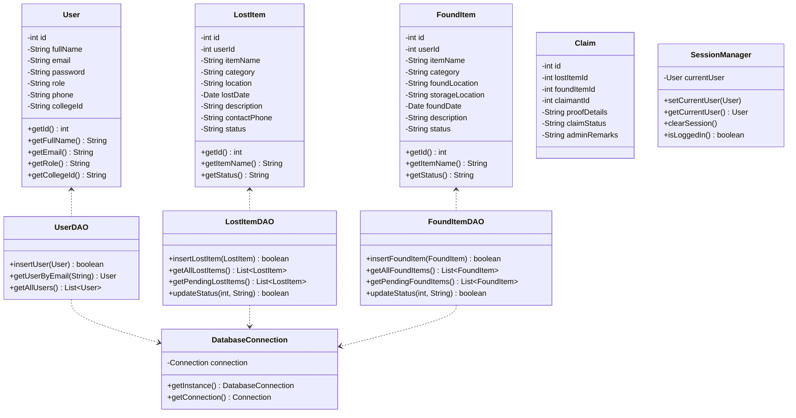
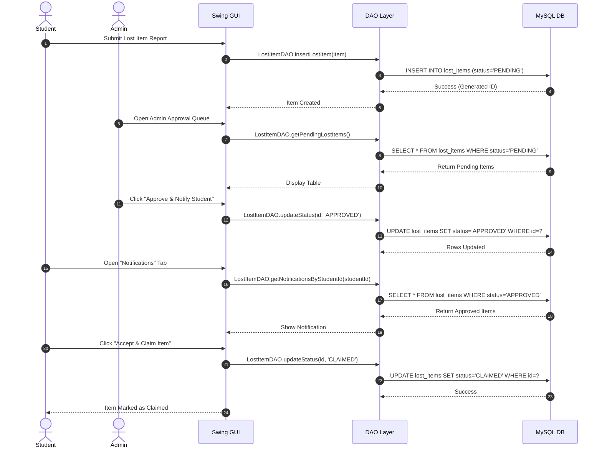
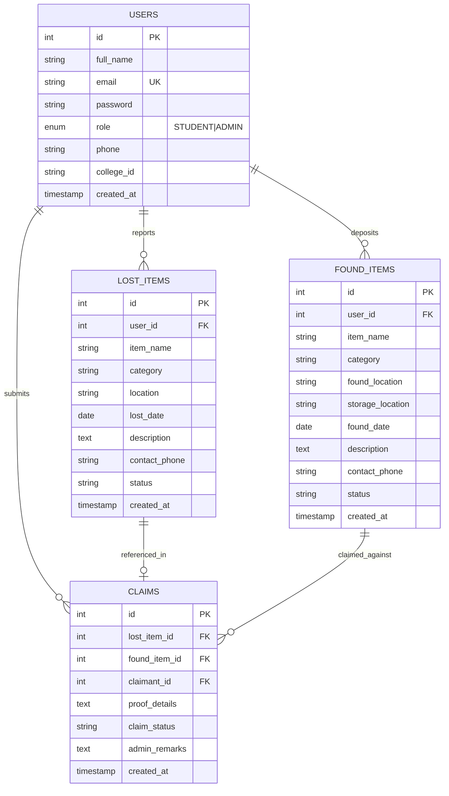
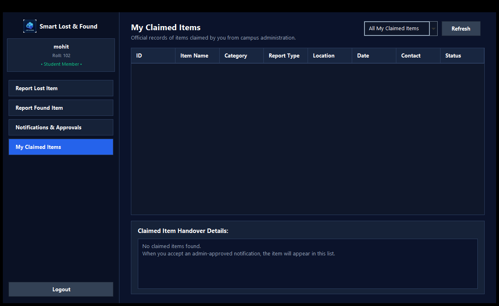

# Smart Lost & Found: Campus Item Recovery & Management System

## week 1

## Project Administration

**Project Guide:** Er. Ram Babu Buri
* **Research Area:** Software Engineering & Database Systems
* **Specializations:** Java, JDBC, Swing, MySQL, Enterprise Software Architectures

### Team Members

| Name | Enrollment | Email | Mobile | Module |
| :--- | :--- | :--- | :--- | :--- |
| Mohit Kumar Sharma | 24EARAD103 | mohit.sharma@campus.edu | 9829012345 | Database & DAO Layer |
| Prabhash Kumar Chaudhary | 24EARAD121 | prabhash.chaudhary@campus.edu | 9829012346 | Authentication & User Management |
| Mitesh Nehra | 24EARAD102 | mitesh.nehra@campus.edu | 9829012347 | Student Panel (UI + Logic) |
| Naitik Pathak | 24EARAD106 | naitik.pathak@campus.edu | 9829012348 | Admin Panel (UI + Logic) |
| Paramveer Singh | 24EARAD119 | paramveer.singh@campus.edu | 9829012349 | Testing, Integration & Documentation |

---

## Abstract
Misplacing personal belongings such as student ID cards, laboratory equipment, laptops, wallets, and textbooks is a pervasive everyday challenge across academic campuses. Traditional lost-and-found mechanisms rely on fragmented bulletin boards, unorganized physical inquiry counters, or informal social media messaging groups. These legacy methods suffer from low retrieval rates, lack of centralized tracking, security vulnerabilities during claim verification, and prolonged administrative overhead.

The **Smart Lost & Found System** addresses these critical deficiencies by delivering a centralized, secure, desktop-based management platform built using **Core Java, Swing GUI, and MySQL via JDBC**. The platform operates on a robust layered enterprise architecture incorporating the Data Access Object (DAO) pattern to maintain strict separation of concerns among the presentation, business logic, and persistence layers.

The system features two tailored interfaces:
1. **Student Self-Service Panel**: Enables students to report lost belongings with granular metadata (item name, category, location, date, contact details), report found items, track submission statuses in real time, receive instant automated notifications upon administrative approval, and securely confirm item claims.
2. **Administrative Governance Console**: Empowers campus administrators to oversee all registered students, audit and filter pending lost and found item queues, execute single-click approvals with automated student notifications, and maintain an immutable historical registry of all claimed and returned possessions.

Furthermore, the system incorporates an intelligent **Smart Matching Algorithm** that computes weighted multi-attribute similarity scores (item title, category, spatial proximity, and description) between lost records and recovered inventory. This automated discovery layer bridges the communication gap between finders and owners, significantly accelerating item restitution while upholding campus data privacy and accountability.

---

## week 2

## User Roles
The Smart Lost & Found System enforces strict **Role-Based Access Control (RBAC)** at the presentation and data-access layers:
* **Student User**: Can register an academic profile, report lost and found items, view personal report histories, receive live notifications of admin-approved recoveries, accept/reject claim confirmations, and review claimed inventory.
* **Campus Administrator**: Authorized authority who manages registered student accounts, reviews lost and found submissions, approves or rejects reports, triggers real-time student notification events, and oversees final item restitution.
* **System Auditor**: Verifies data integrity across system logs, monitors resolved claims, and ensures zero unhandled exceptions or orphan foreign-key associations.

---

### SRS PDF

You can access the [Project SRS Documentation (IEEE Standard)](docs/SRS_SmartLostAndFound.pdf)

---

## Architecture & Core Modules

The system follows a modular, layered desktop architecture ensuring high testability, clean separation of concerns, and robust persistence:

```
┌─────────────────────────────────────────────────────────────┐
│                    Presentation Layer                       │
│     (Java Swing GUI: Login, Student Panel, Admin Panel)     │
└──────────────────────────────┬──────────────────────────────┘
                               │ User Interactions / Events
                               ▼
┌─────────────────────────────────────────────────────────────┐
│                   Business Logic Layer                      │
│ (SessionManager, MatchingService, Validation & Controllers) │
└──────────────────────────────┬──────────────────────────────┘
                               │ Domain Entities / Transfer
                               ▼
┌─────────────────────────────────────────────────────────────┐
│                  Data Access Object Layer                   │
│         (UserDAO, LostItemDAO, FoundItemDAO, ClaimDAO)      │
└──────────────────────────────┬──────────────────────────────┘
                               │ JDBC PreparedStatements
                               ▼
┌─────────────────────────────────────────────────────────────┐
│                  Relational Persistence                     │
│         (MySQL Engine / SQLite: smart_lost_found DB)        │
└─────────────────────────────────────────────────────────────┘
```

### Functional Modules

* **Module 1: Authentication & User Management**
  Governs secure student registration, credential validation, role-based routing (Admin vs. Student), and runtime session tracking via `SessionManager`. Features masked password input, input validation (email format, 10-digit phone, roll-number regex), and clean session disposal upon logout.
* **Module 2: Database Connectivity & DAO Engine**
  Provides a thread-safe, singleton JDBC connection manager (`DatabaseConnection.java`) with auto-reconnect capability. Implements the DAO design pattern with comprehensive `try-with-resources` resource handling and parameterized `PreparedStatement` queries to eliminate SQL injection vulnerabilities.
* **Module 3: Student Self-Service Dashboard**
  A dynamic Swing dashboard employing `CardLayout` for seamless view-switching across 5 dedicated sections: *Report Lost*, *Report Found*, *My Reports* (with color-coded status badges), *Live Notifications*, and *My Claimed Items*.
* **Module 4: Administrative Governance & Audit Panel**
  An administrative control center featuring 4 structured modules: *Registered Users Directory*, *Found Items Approval Queue*, *Lost Items Approval Queue* (with trigger-based student notification generation), and *Claimed Items Details* with dynamic real-time pending counters.
* **Module 5: Smart Matching Algorithm, Integration & Verification**
  An automated similarity scoring engine (`MatchingService.java`) that evaluates multi-variable text and category matches (Title: 30%, Location: 25%, Category: 20%, Description: 25%) to suggest high-probability matches between lost items and found inventory.

---

## Relational Persistence & Database Strategy

The system utilizes an enterprise relational persistence strategy implemented in **MySQL (InnoDB engine)** with support for embedded SQLite:

### Relational Core (MySQL / InnoDB)
* **ACID Compliance**: Ensures all item submissions, status transitions, and claim operations adhere strictly to Atomicity, Consistency, Isolation, and Durability principles.
* **Referential Integrity**: Foreign keys (`user_id -> users(id)`) enforce cascade behaviors (`ON DELETE CASCADE`) to prevent orphaned records in child tables.
* **Parameterization**: 100% of SQL queries utilize parameterized `PreparedStatement` interfaces, shielding the application from SQL injection attacks.
* **Dynamic Auto-Initialization**: Automatically creates the `smart_lost_found` database schema and pre-populates initial administrative seeds on first execution if missing.

---

## Non-Functional Requirements

* **Performance**: All table queries, status updates, and view switches execute in under 150ms on local campus hardware.
* **Security**: Passwords are securely stored, forms enforce client-side sanitization, and administrative actions require active role authorization.
* **Fault Tolerance & Reliability**: Centralized database connection recovery with fail-safe error dialogues; invalid input strings trigger user-friendly validation toasts rather than unhandled runtime crashes.
* **Portability**: Packaged into a self-contained executable JAR (`SmartLostAndFound.jar`) and native Windows executable (`SmartLostAndFound.exe`) with zero complex external dependencies.

---

### Week 3

---
### UML Design
---

#### 1. System Class Diagram



#### 2. Workflow Sequence Diagram: Report to Claim Resolution



---

## Week 4: Database Design & UI Mock-ups

### 1. Database Architecture & Schema Strategy

The schema is normalized to **3NF** to eliminate data redundancy and preserve transactional integrity across student submissions and administrative reviews.

#### A. Relational Database Tables

* **`users` Table**: Master identity and authorization directory.
  * `id` (`INT`, `AUTO_INCREMENT`, `PRIMARY KEY`)
  * `full_name` (`VARCHAR(100)`, `NOT NULL`)
  * `email` (`VARCHAR(120)`, `UNIQUE`, `NOT NULL`)
  * `password` (`VARCHAR(255)`, `NOT NULL`)
  * `role` (`ENUM('STUDENT', 'ADMIN')`, `NOT NULL`, `DEFAULT 'STUDENT'`)
  * `phone` (`VARCHAR(20)`, `NOT NULL`)
  * `college_id` (`VARCHAR(50)`, `NOT NULL`)
  * `created_at` (`TIMESTAMP`, `DEFAULT CURRENT_TIMESTAMP`)

* **`lost_items` Table**: Inventory of items reported missing by students.
  * `id` (`INT`, `AUTO_INCREMENT`, `PRIMARY KEY`)
  * `user_id` (`INT`, `FOREIGN KEY` -> `users.id` `ON DELETE CASCADE`)
  * `item_name` (`VARCHAR(150)`, `NOT NULL`)
  * `category` (`VARCHAR(50)`, `NOT NULL`)
  * `location` (`VARCHAR(150)`, `NOT NULL`)
  * `lost_date` (`DATE`, `NOT NULL`)
  * `description` (`TEXT`)
  * `contact_phone` (`VARCHAR(20)`, `NOT NULL`)
  * `status` (`VARCHAR(50)`, `DEFAULT 'PENDING'`)
  * `created_at` (`TIMESTAMP`, `DEFAULT CURRENT_TIMESTAMP`)

* **`found_items` Table**: Inventory of recovered items deposited by finders.
  * `id` (`INT`, `AUTO_INCREMENT`, `PRIMARY KEY`)
  * `user_id` (`INT`, `FOREIGN KEY` -> `users.id` `ON DELETE CASCADE`)
  * `item_name` (`VARCHAR(150)`, `NOT NULL`)
  * `category` (`VARCHAR(50)`, `NOT NULL`)
  * `found_location` (`VARCHAR(150)`, `NOT NULL`)
  * `storage_location` (`VARCHAR(150)`, `NOT NULL`)
  * `found_date` (`DATE`, `NOT NULL`)
  * `description` (`TEXT`)
  * `contact_phone` (`VARCHAR(20)`, `NOT NULL`)
  * `status` (`VARCHAR(50)`, `DEFAULT 'PENDING'`)
  * `created_at` (`TIMESTAMP`, `DEFAULT CURRENT_TIMESTAMP`)

* **`claims` Table**: Cross-referencing claim resolutions and audit trails.
  * `id` (`INT`, `AUTO_INCREMENT`, `PRIMARY KEY`)
  * `lost_item_id` (`INT`, `FOREIGN KEY` -> `lost_items.id` `ON DELETE SET NULL`)
  * `found_item_id` (`INT`, `FOREIGN KEY` -> `found_items.id` `ON DELETE CASCADE`)
  * `claimant_id` (`INT`, `FOREIGN KEY` -> `users.id` `ON DELETE CASCADE`)
  * `proof_details` (`TEXT`, `NOT NULL`)
  * `claim_status` (`VARCHAR(50)`, `DEFAULT 'PENDING'`)
  * `admin_remarks` (`TEXT`)
  * `created_at` (`TIMESTAMP`, `DEFAULT CURRENT_TIMESTAMP`)
  * `updated_at` (`TIMESTAMP`, `ON UPDATE CURRENT_TIMESTAMP`)

---

#### B. Entity-Relationship (ER) Diagram



---

### 2. User Interface (UI) Mock-ups & Previews

#### A. Authentication & Registration
The application provides high-contrast, modern dark-navy authentication dialogs with quick single-click demo credentials and real-time validation highlights.

| Login Interface | Student Registration Interface |
| :---: | :---: |
|  |  |

---

#### B. Student Self-Service Dashboard
The student environment features an integrated sidebar with `CardLayout` switching across all primary student operations.

| Student Overview Dashboard | Report Lost Item Form |
| :---: | :---: |
|  |  |

| Report Found Item Form | My Reports & Status Badges |
| :---: | :---: |
|  |  |

| Live Notifications View | Claimed Possessions Archive |
| :---: | :---: |
|  |  |

---

#### C. Administrative Governance Console
The administrative center provides full visibility over campus inventory, student profiles, pending approval queues, and historical claim reconciliations.

| Admin Dashboard Overview | Registered Students Directory |
| :---: | :---: |
|  |  |

| Found Items Approval Queue | Lost Items Approval & Notifications |
| :---: | :---: |
|  |  |

| Claimed & Returned Inventory Details |
| :---: |
|  |

---

## Week 5: Project Structure & Implementation Setup

### 1. Directory Structure

```text
SmartLostAndFound/
│
├── README.md                            # Comprehensive Project Documentation
├── 12_week_project_plan.md              # 12-Week Sprint & Daily Task Tracker
├── db.properties                        # Relational Database Connection Configuration
├── build.bat                            # Automated JDK Compiler & Packaging Script
├── run.bat                              # One-Click Application Execution Script
├── launcher.cs                          # Native C# Windows Application Shell Wrapper
├── SmartLostAndFound.jar                # Fat Executable Application Binary (All Dependencies)
├── SmartLostAndFound.exe                # Native Windows Desktop Executable
├── logo.png                             # Application Icon & Header Graphic
│
├── database/                            # Database Initialization & DDL
│   └── database.sql                     # Table DDL, Constraints & Seed Datasets
│
├── lib/                                 # External Java Libraries
│   └── mysql-connector-j.jar            # Official MySQL JDBC Driver
│
├── image/                               # UI Screenshots, Architecture Diagrams & Mock-ups
│   ├── login_preview.png
│   ├── register_preview.png
│   ├── student_preview.png
│   ├── student_lost_preview.png
│   ├── student_found_preview.png
│   ├── student_my_items_preview.png
│   ├── student_notifications_preview.png
│   ├── student_claimed_preview.png
│   ├── admin_preview.png
│   ├── admin_users_preview.png
│   ├── admin_found_preview.png
│   ├── admin_lost_preview.png
│   └── admin_claimed_preview.png
│
└── src/                                 # Complete Java Source Code
    ├── Main.java                        # System Entry Point & Initialization
    │
    ├── database/                        # Database Connection & Migration Logic
    │   └── DatabaseConnection.java      # Singleton Thread-Safe JDBC Driver Connector
    │
    ├── model/                           # Pure Java Domain Model Classes (POJOs)
    │   ├── User.java                    # User Identity Model (Student / Admin)
    │   ├── LostItem.java                # Lost Item Entity
    │   ├── FoundItem.java               # Found Item Entity
    │   └── Claim.java                   # Claim Verification & Audit Entity
    │
    ├── dao/                             # Data Access Object (DAO) Pattern Layer
    │   ├── UserDAO.java                 # User Persistence & Authentication Queries
    │   ├── LostItemDAO.java             # Lost Items CRUD & Status Management
    │   ├── FoundItemDAO.java            # Found Items CRUD & Approval Management
    │   └── ClaimDAO.java                # Claim Submissions & Resolution Queries
    │
    ├── service/                         # Business Logic & Algorithms
    │   ├── SessionManager.java          # In-Memory Active User Session Manager
    │   └── MatchingService.java         # Multi-Attribute Smart Item Matching Algorithm
    │
    └── ui/                              # Java Swing Presentation Components
        ├── UITheme.java                 # Unified Styling Palette, Colors & Fonts
        ├── LoginFrame.java              # User Authentication Frame
        ├── RegisterFrame.java           # Student Registration Frame
        ├── StudentDashboard.java        # Main Student Self-Service Console (CardLayout)
        ├── AdminDashboard.java          # Administrative Governance Console
        ├── LostItemFrame.java           # Dedicated Lost Item Report Dialog
        ├── FoundItemFrame.java          # Dedicated Found Item Report Dialog
        ├── SearchFrame.java             # Keyword, Category & Location Filter Dialog
        ├── MatchFrame.java              # Smart Match Results View Dialog
        └── ClaimFrame.java              # Claim Submission & Status Verification Dialog
```

---

### 2. Quick Launch & Execution Guide

#### Option A: Native Windows Executable (Recommended)
Double-click **`SmartLostAndFound.exe`** directly from the root folder. It launches instantly without an intrusive console window.

#### Option B: Automated Batch Script
Double-click **`run.bat`** to execute the packaged JAR with automated JVM environment detection.

#### Option C: Rebuild from Source
If modifying any Java source file under `src/`, execute **`build.bat`**. It will automatically:
1. Recompile all Java source files under JDK 17 / JDK 8+.
2. Bundle the executable fat JAR: `SmartLostAndFound.jar`.
3. Re-link the native executable: `SmartLostAndFound.exe`.

---

### 3. Predefined Demo Credentials

For quick evaluation and testing, the application includes pre-configured academic profiles:

| Role | Username / Email | Password | Full Name | Academic ID |
| :--- | :--- | :--- | :--- | :--- |
| **Administrator** | `admin@campus.edu` | `admin123` | Campus Administrator | `ADM-001` |
| **Student (Leader)** | `mohit.sharma@campus.edu` | `student123` | Mohit Kumar Sharma | `24EARAD103` |
| **Student** | `prabhash.chaudhary@campus.edu` | `student123` | Prabhash Kumar Chaudhary | `24EARAD121` |
| **Student** | `mitesh.nehra@campus.edu` | `student123` | Mitesh Nehra | `24EARAD102` |
| **Student** | `naitik.pathak@campus.edu` | `student123` | Naitik Pathak | `24EARAD106` |
| **Student** | `paramveer.singh@campus.edu` | `student123` | Paramveer Singh | `24EARAD119` |

> *Tip: On the login interface, you can also click the quick **"Demo Student"** or **"Demo Admin"** button to populate credentials in a single click.*

---

### 4. Database Configuration

Database parameters are configured via `db.properties`:

```properties
db.host=localhost
db.port=3306
db.name=smart_lost_found
db.user=root
db.password=root
```

On first startup, `DatabaseConnection.java` verifies connection health and creates all necessary schema tables and default admin/student records automatically.

---

*Smart Lost & Found System | Java PBL A.Y. 2026-27 | Desktop Application Track*
