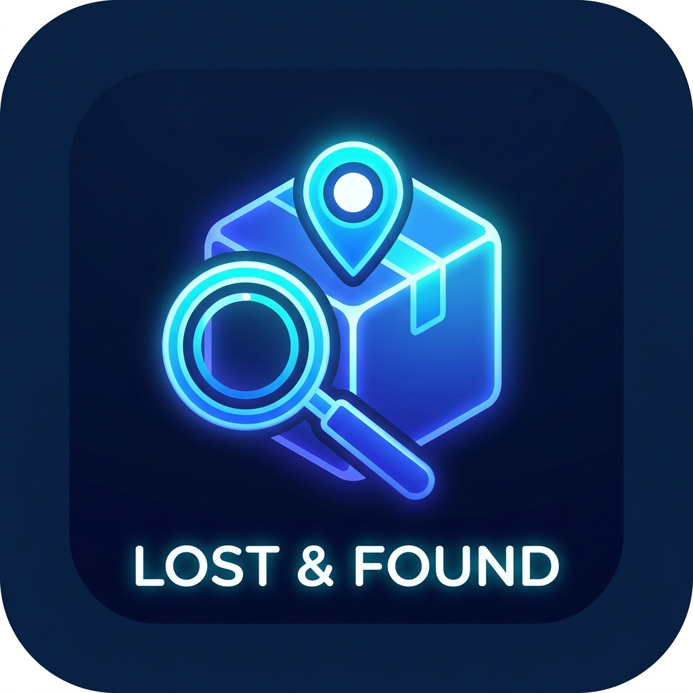
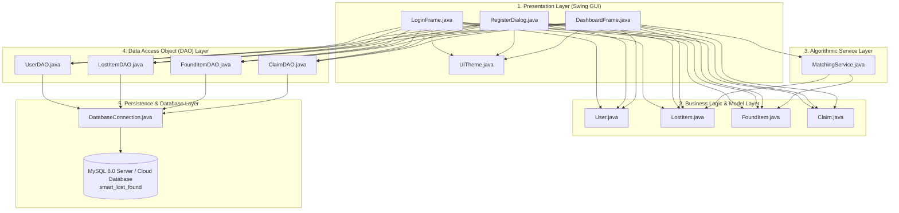
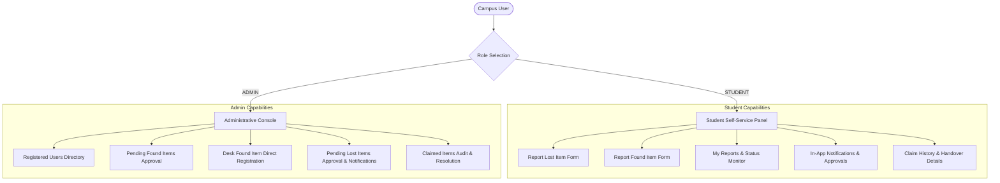
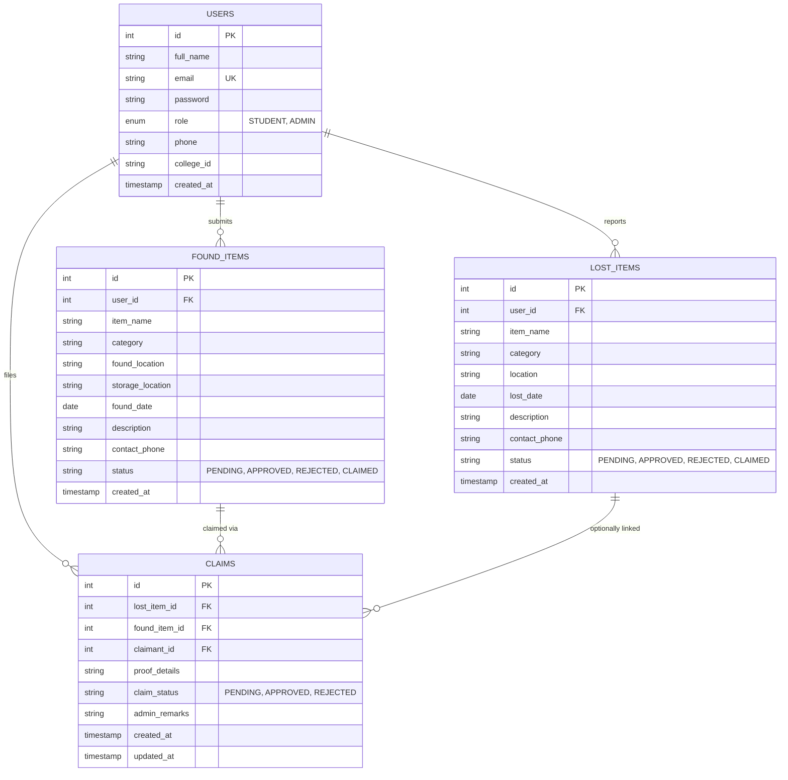

# Smart Lost & Found System
### Campus Property Recovery & Management System

<p align="center">
  
</p>

<p align="center">
  <a href="https://www.oracle.com/java/"></a>
  <a href="https://docs.oracle.com/javase/tutorial/uiswing/"></a>
  <a href="https://www.mysql.com/"></a>
  <a href="https://dev.mysql.com/doc/connector-j/en/"></a>
  <a href="https://www.rtu.ac.in/"></a>
  <a href="LICENSE"></a>
</p>

A stand-alone, high-performance desktop application engineered in **Core Java (JDK 17)** with **Java Swing** and **MySQL / Cloud Database** via **JDBC DAO Pattern**, designed to replace informal campus lost-and-found practices with centralized tracking, administrative approval lifecycle, and intelligent rule-based item matching.

---

## 🏛️ Project Administration

* **Institution:** Arya College of Engineering & Information Technology (ACEIT), Jaipur
* **Department:** Department of Artificial Intelligence & Data Science
* **Affiliation:** Rajasthan Technical University (RTU), Kota (Raj.)
* **Academic Session:** 2026–27 | B.Tech. AI & Data Science (Semester V)
* **Course:** Foundation Course (Tinkering & Elements of Design) / Java PBL Track
* **Project Guide & Mentor:** **Er. Ram Babu Buri**, Assistant Professor
* **Head of Department (HOD):** **Dr. Ashok Kajla**, Professor
* **Project Duration:** 6 July 2026 – 6 October 2026 (13 Weeks | 93 Days)

### 👥 Team Members & Module Allocation

| S.No. | Name | Roll No. | Module |
| :---: | :--- | :---: | :--- |
| 1 | **Mitesh Nehra** | `24EARAD102` | Student Panel (UI + Logic) |
| 2 | **Mohit Kumar Sharma** | `24EARAD103` | Database & DAO Layer |
| 3 | **Naitik Pathak** | `24EARAD106` | Admin Panel (UI + Logic) |
| 4 | **Paramveer Singh** | `24EARAD119` | Testing, Integration & Documentation |
| 5 | **Prabhash Kumar Chaudhary** | `24EARAD121` | Authentication & User Management |


---

### 🔗 Quick Navigation & Project Deliverables

| Deliverable / Resource | Description | Resource Link / Direct Access |
| :--- | :--- | :--- |
| 🚀 **Run the Project** | Step-by-step setup guide, execution instructions & direct link to application distribution directory | [Run the project](Run/Steps.md) \| [Open dist/ Directory](dist/) |
| 📄 **Final Project Report** | Complete Technical Architecture Document, System Requirements Specification, and Evaluation Metrics | [View Project Report](docs/PROJECT_REPORT/project_report.pdf) \| [ARCHITECTURE.md](docs/ARCHITECTURE.md) |
| 📊 **Presentation Deck (PPT)** | 11-Slide B.Tech Final Project Defense Deck covering System Design, Cloud DB, Matching Service & Testing | [View Presentation Details & Slides](docs/PRESENTATION) |
| 🎥 **Video Demonstration** | 5-Minute HD Walkthrough of Smart Lost & Found System (Student Workflow, Matching Engine, Live Cloud DB & Admin Console) | [▶ Watch Video Demonstration](https://drive.google.com/file/d/1vjYQqbe0GBU3cuUvUMAAX_Upbi5egU_J/view?usp=sharing) |
| 📜 **Software Requirements (SRS)** | College Curriculum Format (Arya College / RTU Kota) covering 16 Functional & Non-Functional Requirements, User Roles & Constraints | [View SRS Document](docs/SRS/SRS.pdf) |
| 🔬 **Research Paper** | IEEE Standard Format Academic Research Paper on Campus Property Recovery & Rule-Based Matching Algorithms | [View Research Paper](docs/RESEARCH_PAPER/Smart_Lost_and_Found_Research_Paper.pdf) |
| 📅 **Weekly Data** | Comprehensive Week-by-Week Progress Reports, Milestone Tracking & Member Daily Activity Logs (Weeks 1–13, 6 July – 6 October 2026) | [View Week-by-Week Data](WEEK_WISE_DETAIL.md) |

---

## 📑 Table of Contents

1. [Problem Statement & Objectives](#-problem-statement--objectives)
2. [Key Features](#-key-features)
3. [Technology Stack](#-technology-stack)
4. [Project Modules & Team Responsibilities](#-project-modules--team-responsibilities)
5. [System Architecture & Workflow](#-system-architecture--workflow)
6. [Database Design (Relational 3NF Schema)](#-database-design-relational-3nf-schema)
7. [Project Directory Structure](#-project-directory-structure)
8. [Installation & Execution Instructions](#-installation--execution-instructions)
9. [Screenshots & Visual Design System](#-screenshots--visual-design-system)
10. [Formal Test Suite Checklist](#-formal-test-suite-checklist-100-pass)
11. [Demonstration Accounts](#-demonstration-accounts)
12. [License](#-license)

---

## 🎯 Problem Statement & Objectives

### The Problem
Misplacing personal belongings (student ID cards, lab records, calculators, electronic gadgets, keys, backpacks, and wallets) is a daily logistical headache across university campuses. Conventional campus recovery depends on:
* Informal pinboards and physical security counters with limited hours.
* Fragmented social media messaging groups with high noise and low reachability.
* Unstructured processes with zero remote searchability and high risk of fraudulent claims.
* No centralized audit trail for administration to track whether items were genuinely returned to rightful owners.

### Objectives
1. **Centralized Platform:** Provide a single desktop application for recording, tracking, and claiming lost and found items.
2. **Role-Based Access Control (RBAC):** Separate student self-service capabilities from administrative verification and governance.
3. **Automated Lexical Matching:** Rapidly pair lost reports with recovered inventory using a multi-attribute rule engine (`MatchingService.java`).
4. **Resilient Data Persistence:** Enforce 3NF relational integrity, parameterized SQL to defend against injection, and automatic database schema bootstrapping.
5. **Connection & Socket Lifecycle Management:** Automatically terminate and release cloud database socket slots on window closure (`WindowAdapter`) and JVM shutdown to operate seamlessly within cloud concurrency limits.
6. **Portability:** Provide a self-contained portable Windows executable bundle (`SmartLostAndFound.exe`) with an embedded private Java runtime requiring zero installation.

---

## ⚡ Key Features

### 1. Student Self-Service Portal
* **Report Lost Articles:** Capture item name, category, campus location, loss date, and contact telephone number.
* **Report Found Articles:** Submit recovered property with storage location details (e.g., Proctor Office, Security Desk).
* **My Reports & Real-Time Tracking:** Consolidated dashboard tracking submission statuses (`PENDING`, `APPROVED`, `REJECTED`, `CLAIMED`).
* **Automated Approval Alerts:** Dynamic notifications badge notifying students when campus administrators approve matching submissions.
* **Claim History & Audit:** View resolved claims and confirm item return handovers.

### 2. Administrative Governance Console
* **Direct Desk Entry:** Direct registration modal for recovered belongings handed directly to faculty or proctor office desks.
* **Pending Verification Queue:** Review pending lost and found submissions with student contact numbers prior to publishing.
* **One-Click Approval / Rejection:** Instantly approve or reject items with automated student notification triggers.
* **Student Directory:** Read-only roster of all registered students with roll numbers and contact details.
* **Claimed Items Resolution Registry:** Permanent audit trail documenting claimant name, roll number, and resolution timestamps.

### 3. Intelligent Rule-Based Matching Engine (`MatchingService.java`)
* Multi-attribute comparison evaluating:
  * **Category Match:** Items must belong to identical campus categories (e.g., Electronics, Accessories, Documents).
  * **Substring Match:** Exact case-insensitive title containment.
  * **Token Overlap:** Tokenized set intersection filtered against stop-words (e.g., 'and', 'the', 'with').
* Produces match confidence levels (`HIGH_CONFIDENCE`, `MEDIUM_CONFIDENCE`) to assist staff in rapid pairing.

### 4. Cloud Database Concurrency & Socket Lifecycle Management
* **Instant Window-Close Auto-Cleanup (`WindowAdapter`):** Configured with `DO_NOTHING_ON_CLOSE` on `LoginFrame` and `DashboardFrame` to invoke `DatabaseConnection.closeConnection()`, firing `COM_QUIT` to immediately free active connection slots on cloud MySQL instances in 0 milliseconds.
* **JVM Runtime Shutdown Hook:** Background thread cleanup ensures database sockets are closed cleanly even during sudden process termination (`Alt + F4` or Task Manager).
* **Liveness Validation & Auto-Recovery:** Automatic connection verification (`isValid(2)`) recycles stale sockets before executing queries.
* **Network Resilience:** Configured `connectTimeout=5000` and `socketTimeout=30000` parameters prevent thread blocking during network fluctuations.

---

## 🛠️ Technology Stack

| Component | Technology | Version | Purpose |
| :--- | :--- | :--- | :--- |
| **Language** | Java (OpenJDK / LTS) | Java 17+ | Core application logic, multithreading, and event handling |
| **User Interface** | Java Swing & AWT | Standard Library | Desktop GUI with customized dark theme system (`UITheme.java`) |
| **Database** | MySQL Server / Clever Cloud | 8.0+ | ACID relational persistence with InnoDB engine and utf8mb4 collation |
| **Connectivity** | MySQL Connector/J | 8.x (Type-4) | High-performance pure-Java JDBC driver (`lib/mysql-connector-j.jar`) |
| **Architecture** | Layered Architecture & DAO | Design Pattern | Decoupled presentation, domain models, services, and persistence |
| **Build System** | Windows Batch Automation | `build.bat` | Clean compilation via `javac` and automated JAR packaging |
| **Packaging** | Java Application Packager (`jpackage`) | JDK 17 | Self-contained Windows native executable (`SmartLostAndFound.exe`) |

---

## 👥 Project Modules & Team Responsibilities

| S.No. | Team Member | Roll No. | Assigned Module | Technical Responsibilities |
| :---: | :--- | :---: | :--- | :--- |
| 1 | **Mitesh Nehra** | `24EARAD102` | Student Panel (UI & Logic) | `DashboardFrame.java` (Student CardLayout), lost/found forms, notification badge, claim acceptance workflow. |
| 2 | **Mohit Kumar Sharma** | `24EARAD103` | Database & DAO Layer | Singleton JDBC connection manager, `db.properties` loader, schema bootstrapping, cloud concurrency lifecycle, `database.sql` DDL/DML. |
| 3 | **Naitik Pathak** | `24EARAD106` | Admin Panel (UI & Logic) | `DashboardFrame.java` (Admin CardLayout), verification queue, desk found item entry, student directory, claimed audit. |
| 4 | **Paramveer Singh** | `24EARAD119` | Testing, Integration & Packaging | 35-case formal test suite execution, `build.bat` pipeline, standalone `jpackage` bundling, academic documentation. |
| 5 | **Prabhash Kumar Chaudhary** | `24EARAD121` | Authentication & Security | `LoginFrame.java`, `RegisterDialog.java`, `UserDAO.java`, regex validation (email, 10-digit mobile), RBAC session state. |

---

## 🏗️ System Architecture & Workflow

### 1. Five-Layer System Architecture



### 2. Role-Based Access Control (RBAC) Workflow



---

## 🗄️ Database Design (Relational 3NF Schema)



### Relational Schema Characteristics
* **Third Normal Form (3NF):** Elimination of transitive dependencies; every non-key column depends solely on the primary key.
* **Integrity Constraints:** Foreign keys configure `ON DELETE CASCADE` on child items to prevent orphan records.
* **Parameterized Statements:** All DAO queries utilize `java.sql.PreparedStatement` to ensure input sanitization and prevent SQL injection.

---

## 🗂️ Project Directory Structure

```text
SmartLostAndFound/
├── src/                                     # Java Source Code (5-Layer Modular Architecture)
│   ├── Main.java                            # Entry point & Look-and-Feel initializer
│   ├── dao/                                 # Data Access Object (DAO) classes
│   │   ├── ClaimDAO.java                    # Claim persistence & audit queries
│   │   ├── FoundItemDAO.java                # Found-item persistence & status queries
│   │   ├── LostItemDAO.java                 # Lost-item persistence & approval queries
│   │   └── UserDAO.java                     # User authentication & registration
│   ├── database/
│   │   └── DatabaseConnection.java          # Singleton JDBC manager & schema bootstrapping
│   ├── model/                               # Domain POJO data models
│   │   ├── Claim.java                       # Claim entity
│   │   ├── FoundItem.java                   # Found item entity
│   │   ├── LostItem.java                    # Lost item entity
│   │   └── User.java                        # User entity
│   ├── service/
│   │   └── MatchingService.java             # Multi-attribute similarity algorithm
│   ├── ui/                                  # Java Swing GUI presentation layer
│   │   ├── DashboardFrame.java              # Unified Student & Admin dashboards
│   │   ├── LoginFrame.java                  # Authentication & role selection window
│   │   ├── RegisterDialog.java              # Student self-registration dialog
│   │   └── UITheme.java                     # Dark theme colors, fonts & UI components
│   └── resources/
│       └── logo.png                         # Application branding graphic
│
├── database/
│   └── database.sql                         # Production DDL schema & sample seed data
├── lib/
│   └── mysql-connector-j.jar                # Official MySQL JDBC Type-4 driver
├── dist/                                    # Distribution Packages
│   ├── SmartLostAndFound.zip                # Portable package (27 MB, shared cloud DB)
│   └── SmartLostAndFound/                   # Extracted standalone desktop bundle
│       ├── SmartLostAndFound.exe            # Native Windows executable launcher
│       ├── runtime/                         # Bundled Java 17 runtime (portable)
│       ├── app/
│       │   ├── SmartLostAndFound.jar        # Application executable JAR 
│       │   ├── SmartLostAndFound.cfg        # Java launcher configuration  
│       │   └── db.properties                # Live database configuration  
│       ├── db.properties                    # Live database configuration 
│       └── README_PORTABLE.txt              # Standalone user guide 
│
├── docs/                                    # Academic Project Documentation
│   ├── ARCHITECTURE.md                      # System Architecture Specification
│   ├── PROJECT_REPORT/
│   │   └── PROJECT_REPORT.md                # Academic Project Report
│   ├── RESEARCH_PAPER/
│   │   └── RESEARCH_PAPER.md                # IEEE Format Research Paper
│   ├── SRS/
│   │   └── SRS.md                           # College Format Software Requirements Specification 
│   └── VIDEO/
│       └── demo_video_link.md               # Video Walkthrough Overview & Links 
│
├── week_wise_data.md                        # Complete 12-Week Development Log & Daily Activity Logs 
├── db.properties                            # Root database configuration (git-ignored) 
├── db.properties.example                    # Git-safe configuration template  
├── build.bat                                # Rebuild Java sources & package JAR 
├── setup_jdk.ps1                            # Portable JDK 17 download script 
├── LICENSE                                  # MIT License 
└── README.md                                # Main Project Documentation 
```
<a id="run-the-project"></a>
## 🚀 Installation & Execution Instructions

### Option A: Run the Portable Executable (Recommended)
1. Navigate directly to the **[`dist/` directory](dist/)** or extract **`dist/SmartLostAndFound.zip`** to any directory (e.g., Desktop or `C:\SmartLostAndFound`).
2. Ensure your computer is connected to the Internet (Wi-Fi or Mobile Hotspot).
3. Double-click **`SmartLostAndFound.exe`** located in **[`dist/SmartLostAndFound/`](dist/SmartLostAndFound/)**.
4. The application launches immediately — **no Java or MySQL installation required**!

### Option B: Build & Run from Source Code
1. **Prerequisites:** Install **JDK 17+** and ensure `javac` is available in your PATH.
2. **Database Configuration:**
   * Copy the template configuration file:
     ```cmd
     copy db.properties.example db.properties
     ```
   * Configure your MySQL host, port, credentials, and database name in `db.properties`.
   * (Optional) If hosting locally, import the initial schema:
     ```cmd
     mysql -u root -p < database/database.sql
     ```
3. **Compile & Package:**
   * Run the automated build script:
     ```cmd
     build.bat
     ```
4. **Execute the Application:**
   * Launch the packaged JAR:
     ```cmd
     java -jar dist/SmartLostAndFound/app/SmartLostAndFound.jar
     ```
---

## 🖼️ Screenshots & Visual Design System

The application features a modern, eye-friendly dark design system implemented via `src/ui/UITheme.java`:

| Palette Element | Color Hex | Usage |
| :--- | :--- | :--- |
| **Dark Canvas** | `#1e1e2f` | Frame window background and primary canvases |
| **Card / Surface** | `#27293d` | Content panels, tables, input cards, and sidebar containers |
| **Accent Primary** | `#7b68ee` | Primary action buttons, selection highlights, active indicators |
| **Status: Approved** | `#2ecc71` | Approved status chips and success dialogs |
| **Status: Pending** | `#f39c12` | Pending review status indicators |
| **Status: Rejected** | `#e74c3c` | Rejected status badges and validation alerts |

### User Interface Tour
* **Login & Registration Window:** Sleek modal with academic ID, phone number formatting checks, and role radio buttons (`STUDENT` vs `ADMIN`).
* **Student Self-Service Dashboard:** Sidebar navigation using `CardLayout` across 5 panels (Report Lost, Report Found, My Reports, In-App Notifications, My Claimed Items).
* **Administrative Console:** Sidebar navigation across 5 governance views (Registered Students, Review Found Items, Desk Direct Registration, Review Lost Items, Claimed Items Audit).

> *Note: Users can view the live interface instantly by launching `dist/SmartLostAndFound/SmartLostAndFound.exe` or by compiling from source.*

---

## 🧪 Formal Test Suite Checklist (100% Pass)

The project underwent comprehensive verification across 35 formal test cases. The core representative scenarios are outlined below :

| Test ID | Test Scenario | Input Data | Expected Result | Actual Result | Status |
| :--- | :--- | :--- | :--- | :--- | :---: |
| **TC-01** | System Launch | Application start | Login window renders without errors | Login window opens without error | **PASS** |
| **TC-02** | Student Login | Valid student credentials | Student dashboard opens | Student dashboard opens | **PASS** |
| **TC-03** | Admin Login | Valid admin credentials | Admin dashboard opens | Admin dashboard opens | **PASS** |
| **TC-04** | Invalid Password | Incorrect password | Error dialog displayed; access denied | Error message; no dashboard access | **PASS** |
| **TC-05** | Student Registration | Valid form data | New user created; success message shown | Account is saved and success feedback appears | **PASS** |
| **TC-06** | Duplicate Email | Existing email | Rejection dialog displayed; no duplicate created | Registration is rejected | **PASS** |
| **TC-07** | Lost Item Submission | Required fields | Record saved with `PENDING` status | Record is saved and appears in list | **PASS** |
| **TC-08** | Missing Fields | Blank name/location | Form rejected with validation alert | Validation message appears; record not saved | **PASS** |
| **TC-09** | Found Item Submission | Valid form data | Record saved with `PENDING` status | Record is saved and visible for review | **PASS** |
| **TC-10** | Item Filter / Search | Keyword query | Matching items displayed in table | Relevant records are displayed | **PASS** |
| **TC-11** | Smart Match Search | Sample records | Potential match identified by algorithm | Candidate matches and score are displayed | **PASS** |
| **TC-12** | Submit Item Claim | Valid claim | Claim recorded in database with `PENDING` status | Claim is stored with pending status | **PASS** |
| **TC-13** | Admin Report Approval | Approve button | Status changes to `APPROVED`; notification generated | Database and relevant views show updated status | **PASS** |
| **TC-14** | Data Persistence | App restart | Previously saved records remain intact | Persisted records remain available | **PASS** |
| **TC-15** | SQL Injection Defense | `' OR '1'='1` | Input stored harmlessly as literal string | Input treated as data, not executable SQL | **PASS** |
| **TC-16** | Session Logout | Logout button | Session terminated; login window reopened | Session ends and login screen is shown | **PASS** |
| **TC-17** | Window Close DB Cleanup | User clicks 'X' (Close) button | Database connection closes immediately; Cloud slot released | Connection closed cleanly on window close | **PASS** |
| **TC-18** | Shutdown Hook Trigger | Process terminated / Alt+F4 | JVM shutdown hook executes `closeConnection()` | Hook executes and disconnects from DB | **PASS** |
| **TC-19** | Network Liveness Check | Reconnect after network drop | `isConnectionAlive()` detects dead socket and reconnects | Fresh connection established automatically | **PASS** |

---

## 🔑 Demonstration Accounts

| Role | Email Address | Password | Full Name | Academic ID |
| :--- | :--- | :--- | :--- | :--- |
| **Administrator** | `admin@campus.edu` | `admin123` | Campus Administrator | `ADM-001` |
| **Student** | `mohit.sharma@campus.edu` | `student123` | Mohit Kumar Sharma | `24EARAD103` |
| **Student** | `mitesh.nehra@campus.edu` | `student123` | Mitesh Nehra | `24EARAD102` |
| **Student** | `prabhash.chaudhary@campus.edu` | `student123` | Prabhash Kumar Chaudhary | `24EARAD121` |
| **Student** | `naitik.pathak@campus.edu` | `student123` | Naitik Pathak | `24EARAD106` |
| **Student** | `paramveer.singh@campus.edu` | `student123` | Paramveer Singh | `24EARAD119` |

> *New students can also click **"Register as New Student"** on the login screen to create a new profile.*

--

## 📄 License
This project is licensed under the [MIT License](LICENSE) — developed for the B.Tech. AI & Data Science Foundation Course at Arya College of Engineering & Information Technology (RTU Kota).

