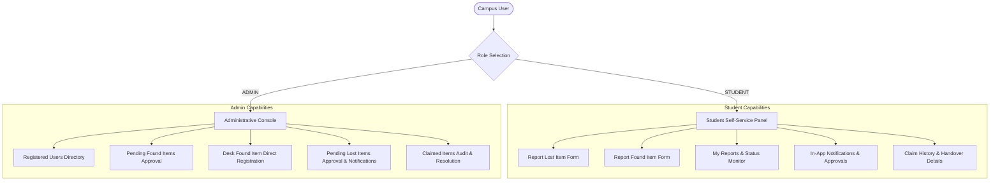
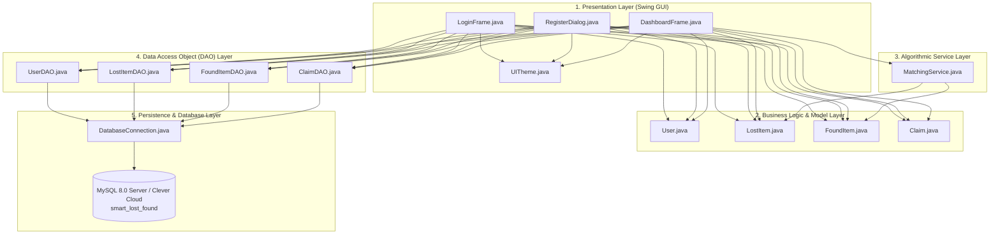
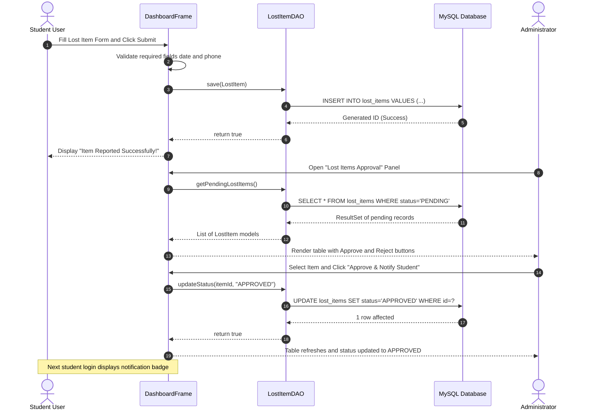
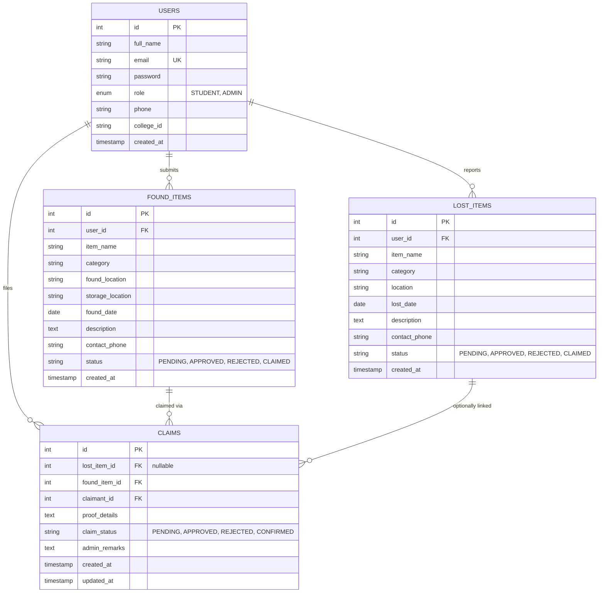
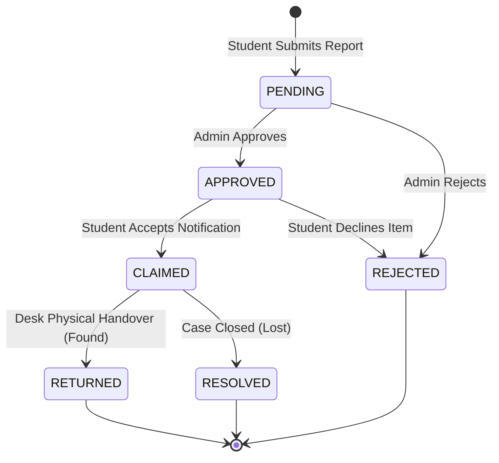

# 📅 13-Week Project Development Plan & Daily Activity Logs
### Smart Lost & Found System — Campus Property Recovery & Management System

---

## 🏛️ Project Administration

* **Institution:** Arya College of Engineering & Information Technology (ACEIT), Jaipur
* **Department:** Department of Artificial Intelligence & Data Science
* **Affiliation:** Rajasthan Technical University (RTU), Kota (Raj.)
* **Academic Session:** 2026–27 | B.Tech. AI & Data Science (Semester V)
* **Course:** Foundation Course (Tinkering & Elements of Design) / Java PBL Track
* **Project Guide & Mentor:** **Er. Ram Babu Buri**, Assistant Professor
* **Head of Department (HOD):** **Dr. Ashok Kajla**, Professor
* **Project Duration:** 6 July 2026 – 6 October 2026 (13 Weeks | 93 Days)

---

### 🔗 Quick Navigation & Repository Artifacts

| Resource | Description | Direct Access |
| :--- | :--- | :--- |
| 🏠 **Main Documentation** | Complete system overview, architecture, setup guide & test suite | [Open README.md](README.md) |
| 🏗️ **System Architecture** | Decoupled 5-layer modular architecture and component specifications | [Open ARCHITECTURE.md](docs/ARCHITECTURE.md) |
| 📜 **Software Requirements (SRS)** | College format curriculum SRS covering 16 functional requirements | [Open SRS.md](docs/SRS/SRS.md) |
| 📄 **Academic Project Report** | Comprehensive academic report, capabilities, and evaluation metrics | [Open PROJECT_REPORT.md](docs/PROJECT_REPORT/PROJECT_REPORT.md) |
| 📊 **Project Presentation (PPT)** | 16-Slide project defense presentation deck, slide structure & access links | [Open presentation_link.md](docs/PRESENTATION/presentation_link.md) |
| 🔬 **Research Paper** | IEEE standard format research paper on campus property recovery | [Open RESEARCH_PAPER.md](docs/RESEARCH_PAPER/RESEARCH_PAPER.md) |
| 🎥 **Video Demonstration** | 10-Minute HD walkthrough video outline, segments, and access links | [Open demo_video_link.md](docs/VIDEO/demo_video_link.md) |

---

### 📌 Project Standards & Log Verification

| Parameter | Status | Specification & Implementation Details |
| :--- | :---: | :--- |
| 🛡️ **Daily Developer Logs** | `100% VERIFIED` | Complete daily activity logs preserved verbatim for all 5 team members across Weeks 1–13 (Monday–Sunday / Tuesday, 93 Days). |
| ⚙️ **Standard Tech Stack** | `JAVA 17 + MYSQL` | Standardized on **Core Java 17**, **Java Swing (Dark UI)**, **MySQL 8.0 / Cloud DB**, and **JDBC DAO** compiled via `build.bat`. |
| 🧪 **Formal Test Suite** | `35/35 PASS` | Comprehensive 35-case test suite with 19 core scenarios detailed in [Section 10.1](#week-10) (0 defects). |
| ⚡ **Socket Concurrency** | `AUTO-RELEASE` | Automated `WindowAdapter` & JVM shutdown hooks immediately free cloud database connection slots on app close. |
| 📋 **Evaluation Checklist** | `100 MARKS` | Aligned with the formal 8-component academic evaluation rubric detailed in [Section 13.2](#week-13). |

---

## 📑 Table of Contents

* [Week 1: Team Formation, Topic Selection & Abstract (6 Jul – 12 Jul 2026)](#week-1)
  * [1.1 Academic Abstract](#11-academic-abstract)
  * [1.2 Module Allocations & Deliverables](#12-module-allocations--deliverables)
  * [1.3 Week 1 Daily Activity Log](#13-week-1-daily-activity-log)
* [Week 2: Software Requirements Specification (SRS) & Architecture (13 Jul – 19 Jul 2026)](#week-2)
  * [2.1 Role-Based Access Control (RBAC) Specification](#21-role-based-access-control-rbac-specification)
  * [2.2 Functional Requirements Summary (FR-01 to FR-16)](#22-functional-requirements-summary-fr-01-to-fr-16)
  * [2.3 Week 2 Daily Activity Log](#23-week-2-daily-activity-log)
* [Week 3: UML Modeling & System Architecture Design (20 Jul – 26 Jul 2026)](#week-3)
  * [3.1 Five-Layer System Architecture](#31-five-layer-system-architecture)
  * [3.2 Sequence Diagram: Lost Item Submission & Admin Approval](#32-sequence-diagram-lost-item-submission--admin-approval)
  * [3.3 Week 3 Daily Activity Log](#33-week-3-daily-activity-log)
* [Week 4: Database Schema Design & UI Wireframes (27 Jul – 2 Aug 2026)](#week-4)
  * [4.1 Relational Schema & Tables Definition (3NF)](#41-relational-schema--tables-definition-3nf)
  * [4.2 Predefined Demonstration Accounts](#42-predefined-demonstration-accounts)
  * [4.3 Week 4 Daily Activity Log](#43-week-4-daily-activity-log)
* [Week 5: Module Coding Phase 1 — Core DAOs & Foundation (3 Aug – 9 Aug 2026)](#week-5)
  * [5.1 Engineering Focus](#51-engineering-focus)
  * [5.2 Week 5 Daily Activity Log](#52-week-5-daily-activity-log)
* [Week 6: Module Coding Phase 2 — Workflows & Notifications (10 Aug – 16 Aug 2026)](#week-6)
  * [6.1 Status Lifecycle Engine](#61-status-lifecycle-engine)
  * [6.2 Week 6 Daily Activity Log](#62-week-6-daily-activity-log)
* [Week 7: Module Coding Phase 3 — Claims & Form Validation (17 Aug – 23 Aug 2026)](#week-7)
  * [7.1 Engineering Focus](#71-engineering-focus)
  * [7.2 Week 7 Daily Activity Log](#72-week-7-daily-activity-log)
* [Week 8: Module Coding Phase 4 — Smart Matching & Final Polish (24 Aug – 30 Aug 2026)](#week-8)
  * [8.1 Multi-Attribute Matching Algorithm (MatchingService.java)](#81-multi-attribute-matching-algorithm-matchingservicejava)
  * [8.2 Week 8 Daily Activity Log](#82-week-8-daily-activity-log)
* [Week 9: System Integration & Cross-Module Verification (31 Aug – 6 Sep 2026)](#week-9)
  * [9.1 Engineering Focus](#91-engineering-focus)
  * [9.2 Week 9 Daily Activity Log](#92-week-9-daily-activity-log)
* [Week 10: System Testing, Performance & Native Packaging (7 Sep – 13 Sep 2026)](#week-10)
  * [10.1 Formal Test Suite Checklist](#101-formal-test-suite-checklist-key-representative-scenarios)
  * [10.2 Standalone Packaging & Cloud Database Lifecycle](#102-standalone-packaging--cloud-database-lifecycle)
  * [10.3 Week 10 Daily Activity Log](#103-week-10-daily-activity-log)
* [Week 11: Project Documentation, Research Paper & Media (14 Sep – 20 Sep 2026)](#week-11)
  * [11.1 Academic Project Report & Paper Structure](#111-academic-project-report--paper-structure)
  * [11.2 Week 11 Daily Activity Log](#112-week-11-daily-activity-log)
* [Week 12: Final Documentation Polish & Code Freeze (21 Sep – 27 Sep 2026)](#week-12)
  * [12.1 Final Deliverable Release Summary](#121-final-deliverable-release-summary)
  * [12.2 Week 12 Daily Activity Log](#122-week-12-daily-activity-log)
* [Week 13: Final Submission & Project Completion (28 Sep – 6 Oct 2026)](#week-13)
  * [13.1 Final Deliverables & Project Submission Checklist](#131-final-deliverables--project-submission-checklist)
  * [13.2 Formal Evaluation Checklist (100 Marks Rubric)](#132-formal-evaluation-checklist-100-marks-rubric)
  * [13.3 Week 13 Daily Activity Log](#133-week-13-daily-activity-log)

---

## 🔹 Week 1: Team Formation, Topic Selection & Abstract
**Duration:** 6 July 2026 – 12 July 2026

### 1.1 Academic Abstract
Misplacing personal belongings such as student identity cards, laboratory manuals, electronic gadgets, backpacks, keys, and wallets is an enduring logistical challenge across university campuses. Conventional campus recovery practices rely on informal pinboards, word of mouth, and unstructured social media chat groups. These outdated channels suffer from acute information fragmentation, zero remote searchability, vulnerable ownership verification, and high administrative latency.

The **Smart Lost & Found System** resolves these deficiencies by introducing a centralized, secure desktop application engineered with **Core Java (JDK 17)**, **Java Swing**, and **MySQL relational persistence** via **JDBC** and the **Data Access Object (DAO)** pattern. The system implements strict **Role-Based Access Control (RBAC)** across two synchronized dashboards:
1. **Student Self-Service Panel:** Enables students to report lost articles, submit found belongings, track status changes in real-time, receive administrative approval alerts, and claim matching articles.
2. **Administrative Governance Console:** Empowers campus staff to verify incoming reports, register items received at the campus desk, approve/reject submissions, and maintain an audit log of claimed items.

### 1.2 Module Allocations & Deliverables
* Team registration completed on the academic project portal under **Er. Ram Babu Buri**.
* Initial Git repository initialized with basic Maven/Java project folders.
* Initial high-level feature list and problem definition approved.

### 1.3 Week 1 Daily Activity Log

| Member | Mon (6 Jul) | Tue (7 Jul) | Wed (8 Jul) | Thu (9 Jul) | Fri (10 Jul) | Sat (11 Jul) | Sun (12 Jul) |
| :--- | :--- | :--- | :--- | :--- | :--- | :--- | :--- |
| **Mohit Kumar** | Today I registered our team on the portal and picked our guide. I also made the GitHub repo and the basic Maven project folders. | I tried to understand the problem properly. I wrote down what data we need to save and what the Admin and Student can do. | I looked at a few lost and found websites online to see what features they have. Then I made a smaller feature list for our college project. | I wrote the project abstract (about 250 words) with the problem, our idea and the tools we will use. I sent it to the team to check. | I fixed the abstract after the team's suggestions. Then I did my first proper commit on GitHub with the project folders and the abstract. | **Mentor meeting.** I told the mentor our idea and showed the abstract. I noted the feedback and updated the tracking sheet. | I read the mentor's feedback again. I also made a rough list of database tables and what columns each one needs. |
| **Prabhash Kumar** | I joined the team today, made my GitHub account and joined the repo. My part is login, register, session and role access. | I understood the project idea and how login is different for Admin and Student. I listed the fields needed to register. | I read about making login screens in Java Swing, like hiding the password and showing error pop-ups. | I wrote 2-3 lines about the login part for the abstract and sent them to Mohit. We also talked about the fields on the screens. | I made empty LoginFrame, RegisterFrame and User files and did my first GitHub commit. I also looked at the folder setup. | **Mentor meeting.** I attended and noted the mentor's feedback about login. I helped update the tracking sheet. | I read the feedback and learned how to put my files in the right package folder. |
| **Mitesh Nehra** | I joined the team and understood my part, the Student Panel. I will make everything a student sees: report lost, report found, my reports, notifications and claimed items. | I understood the student's journey: register, login, report an item, wait for admin approval, get a notification, accept or reject it and then see it in claimed items. | I read about making a sidebar dashboard in Java Swing using CardLayout, and about tables and scroll panes. | I wrote 2-3 lines about the student panel for the abstract and sent them to Mohit. We also talked about the sections it needs. | I made empty StudentDashboard and LostItem files and did my first GitHub commit. | **Mentor meeting.** I attended and noted what the mentor expects from the student features. I helped update the tracking sheet. | I made a final list of 5 sections to build: Report Lost, Report Found, My Reports, Notifications and My Claimed Items. |
| **Naitik Pathak** | I joined the team today. My part is the Admin Panel with 4 sections: Registered Users, Found Items Approval, Lost Items Approval and Claimed Items. | I understood what the admin does: see all students, approve or reject lost and found reports, notify students and track claimed items. | I read about making table screens in Java Swing using JTable and how to get the selected row to do an action. | I wrote 2-3 lines about the admin panel for the abstract and sent them to Mohit. I also talked with Mitesh about how approval connects to notifications. | I made empty AdminDashboard and FoundItem files and did my first GitHub commit. | **Mentor meeting.** I attended and noted what the mentor expects from the admin panel. I helped update the tracking sheet. | I studied the 4 admin sections and noted for each one what data to show and what the buttons will do. |
| **Paramveer Singh** | I joined the team today. My part is testing, joining everything together and documents. I will do the SRS, test cases, report, PPT, video and GitHub tracking. | I understood the full system from both sides: the student registering and claiming an item, and the admin approving items and tracking claims. | I read about the types of testing (unit, integration, system and user acceptance) and about the IEEE SRS format. | I wrote 2-3 lines about testing and documents for the abstract. I also made the testing and docs folders on GitHub. | I added all 5 members on GitHub and made a TestPlan.md with columns for test ID, steps, expected result, actual result and status. | **Mentor meeting.** I attended as note-taker, wrote down all the feedback and made the weekly tracking sheet. I pushed it to GitHub. | I read all the feedback notes and made a plan for the test cases. I added the first test scenarios to the test plan. |

---

## 🔹 Week 2: Software Requirements Specification (SRS) & Architecture
**Duration:** 13 July 2026 – 19 July 2026

### 2.1 Role-Based Access Control (RBAC) Specification

### 2.2 Functional Requirements Summary (FR-01 to FR-16)

| Req ID | Requirement Statement | Priority | Module |
| :--- | :--- | :--- | :--- |
| **FR-01** | Student self-registration with full name, college roll number/ID, 10-digit mobile number, college email, password and confirmation. | High | Auth |
| **FR-02** | Validation rejection for blank fields, non-10-digit mobile numbers, malformed email, password mismatch, or duplicate email. | High | Auth |
| **FR-03** | User authentication by email and password with role matching. | High | Auth |
| **FR-04** | Lost-item reporting with item title, category, campus location, date (YYYY-MM-DD), and contact phone. | High | Student |
| **FR-05** | Found-item reporting with storage location, finder contact, and recovery details. | High | Student |
| **FR-06** | Form input validation rejecting invalid dates and non-numeric phone values prior to database save. | High | Student/Admin |
| **FR-07** | Automatic assignment of `PENDING` status upon report creation. | High | DAO / DB |
| **FR-08** | Administrator queue for reviewing pending lost and found records with reporter contact details. | High | Admin |
| **FR-09** | Automated student notification generation when a lost report is approved by administrator. | High | Student/Admin |
| **FR-10** | Direct desk registration of recovered belongings handed to administration staff. | Medium | Admin |
| **FR-11** | Administrative view of all registered student profiles (name, email, phone, college ID). | Medium | Admin |
| **FR-12** | Claimed items audit registry displaying claimant identity, roll number, and handover timestamps. | Medium | Admin/Student |
| **FR-13** | Dynamic table filtering and manual list refresh controls across all dashboard views. | Low | UI / Theme |
| **FR-14** | Rule-based lexical matching comparing lost and found records (`MatchingService.java`). | Medium | Service |
| **FR-15** | Persistent ACID storage in MySQL with automated schema bootstrapping on initial launch. | High | Database |
| **FR-16** | Clean user session termination and secure return to login interface upon logout. | High | UI / Auth |

### 2.3 Week 2 Daily Activity Log

| Member | Mon (13 Jul) | Tue (14 Jul) | Wed (15 Jul) | Thu (16 Jul) | Fri (17 Jul) | Sat (18 Jul) | Sun (19 Jul) |
| :--- | :--- | :--- | :--- | :--- | :--- | :--- | :--- |
| **Mohit Kumar** | I wrote the first part of the SRS (Introduction). It covers the purpose, scope and a short overview of our system. | I wrote the second part of the SRS. It explains that it is a desktop app, who the users are (Admin, Student) and what it runs on. | I wrote the database requirements for the SRS. I listed the three tables and the four status values: Pending, Approved, Rejected and Claimed. | I wrote short use-cases for saving a user, saving a lost item and changing the status of an item. | We checked the full SRS together and made sure everyone's part was included. I fixed small mistakes and pushed it to GitHub. | **Mentor meeting.** I showed the SRS and the mentor approved it. I noted the small corrections and updated the tracking sheet. | I made the mentor's corrections in the SRS and finished it. I also thought about the database design for next week. |
| **Prabhash Kumar** | I wrote the first login and register requirements: register with details, check the email format and do not allow the same email twice. | I wrote more requirements: login with email and password, open the Admin or Student screen by role, and logout from any screen. | I wrote the non-functional requirements: login should be fast, the password should be hidden and the session stays in memory. | I wrote the use-cases for Login and Register with the normal steps and what happens for a wrong password or the same email. | I finished my SRS part and gave it to Paramveer. I also pushed the updated SRS to GitHub. | **Mentor meeting.** I told the mentor about my login requirements and noted the feedback. I helped update the tracking sheet. | I fixed the SRS as the mentor said. I also planned how the login and register screens will look. |
| **Mitesh Nehra** | I wrote the first student requirements: report a lost item with name, description, place and date, and report a found item the same way. | I wrote that the student can see all their reports with the status and get notifications for items approved by the admin. | I wrote that the student can accept or reject a notification, accepted items go to My Claimed Items and the student can logout. | I wrote the use-cases for Report Lost Item and Accept Notification with the steps and what happens in other cases. | I finished my SRS part, gave it to Paramveer and pushed it to GitHub. | **Mentor meeting.** I told the mentor my student panel requirements and noted the feedback. I helped update the tracking sheet. | I read the mentor's feedback and planned how all 5 student sections will look. |
| **Naitik Pathak** | I wrote the first admin requirements: view all students, view pending found items and approve or reject a found item. | I wrote more requirements: view pending lost items, approve one and notify the student, and reject one. | I wrote that after a student accepts, the item goes to the Claimed Items section and the admin can see claimed items with student details. | I wrote the use-cases for Approve Lost Item and View Claimed Items with the steps and other cases. | I finished my SRS part, gave it to Paramveer and pushed it to GitHub. | **Mentor meeting.** I told the mentor my admin requirements and noted the feedback. I helped update the tracking sheet. | I read the mentor's feedback and planned how the 4 admin sections will look. |
| **Paramveer Singh** | I started the full SRS document. I made the title page, contents and Section 1 and started collecting input from everyone. | I wrote SRS Section 1: purpose, scope, definitions (DAO, JDBC, role-based access) and overview. | I collected the requirements of all 4 modules (login, student, admin and database) and gave them numbers like FR-01, FR-02. | I wrote the system limits (Windows, JDK 8+, SQLite, 512 MB RAM), the assumptions and a small glossary. | I finished the SRS with proper headings, page numbers and contents. I pushed the SRS PDF to GitHub. | **Mentor meeting.** I gave the SRS draft to the mentor and noted the corrections. I updated the tracking sheet. | I added all the mentor's corrections to the SRS and pushed the final SRS to GitHub. |

---

## 🔹 Week 3: UML Modeling & System Architecture Design
**Duration:** 20 July 2026 – 26 July 2026

### 3.1 Five-Layer System Architecture

### 3.2 Sequence Diagram: Lost Item Submission & Admin Approval

### 3.3 Week 3 Daily Activity Log

| Member | Mon (20 Jul) | Tue (21 Jul) | Wed (22 Jul) | Thu (23 Jul) | Fri (24 Jul) | Sat (25 Jul) | Sun (26 Jul) |
| :--- | :--- | :--- | :--- | :--- | :--- | :--- | :--- |
| **Mohit Kumar** | I made the ER diagram on draw.io with the three tables, their keys and how they connect. | I added the User, LostItem and FoundItem classes to the team's class diagram. I also added the DAO classes and the database connection class. | I made the sequence diagram for reporting a lost item. I also looked at my teammates' diagrams to see if they match. | I checked all the diagrams to make sure the class names are the same as the ones we will use in the code. I fixed the ones that did not match. | I saved my ER and class diagrams as images and put them on GitHub. I also helped Paramveer put all diagrams in one PDF. | **Mentor meeting.** I showed the ER and class diagrams and got approval. I updated the tracking sheet. | I read the mentor's feedback on the diagrams. I fixed the ER diagram by adding the missing NOT NULL parts and correcting one relationship. |
| **Prabhash Kumar** | I made the use-case diagram for login, register and logout for the Student and Admin on draw.io. | I added LoginFrame, RegisterFrame and SessionManager to the class diagram with their main methods. | I made the activity diagram for login: enter details, check them, then open the Admin or Student screen. | I made the activity diagram for register: fill the form, check the email, check for duplicates, save and go to login. | I saved all my diagrams as images, put them on GitHub and sent them to Paramveer for the PDF. | **Mentor meeting.** I showed my diagrams and changed the activity diagram a little as the mentor said. I updated the tracking sheet. | I fixed my diagrams using the mentor's feedback and planned the coding of the login and register screens. |
| **Mitesh Nehra** | I made the use-case diagram for the student: report lost, report found, view reports, view notifications, accept, reject and view claimed items. | I added StudentDashboard to the class diagram with a method to show each of the 5 panels. | I made the sequence diagram for reporting a lost item: click submit, read the form, save in the database and show a success message. | I made the sequence diagram for accepting a notification: click Accept, status changes to Claimed and the item shows in My Claimed Items. | I saved my diagrams as images, pushed them to GitHub and sent them to Paramveer for the PDF. | **Mentor meeting.** I showed my diagrams and changed one sequence diagram as the mentor said. I updated the tracking sheet. | I fixed my diagrams using the mentor's feedback and planned the dashboard coding for next week. |
| **Naitik Pathak** | I made the use-case diagram for the admin: view users, approve or reject found items, approve and notify or reject lost items and view claimed items. | I added AdminDashboard to the class diagram with a method for each of the 4 sections. | I made the sequence diagram for approving a lost item: click Approve, status becomes Approved and the student gets the notification. | I made the sequence diagram for claimed items: the student accepts, status becomes Claimed and the item shows in Claimed Items. | I saved my diagrams as images, pushed them to GitHub and sent copies to Paramveer. | **Mentor meeting.** I showed my diagrams and fixed one sequence diagram as the mentor said. I updated the tracking sheet. | I fixed my diagrams as the mentor said and planned the admin dashboard coding. |
| **Paramveer Singh** | I started collecting all the UML diagrams from the team into one folder. I also made the system architecture diagram (UI, logic, DAO, database). | I joined and checked the use-case diagram so that all actors and use cases are in one clear diagram. | I checked everyone's sequence diagrams to see that they show the right DAO calls and the right class names. | I made the deployment diagram: user machine, Java, Swing app, JDBC driver and the SQLite file. | I put all diagrams (ER, use-case, class, sequence, activity, deployment) in one UML PDF and pushed it to GitHub. | **Mentor meeting.** I showed the full set of diagrams and got approval. I updated the tracking sheet. | I added the mentor's corrections to the UML PDF and pushed the final one. |

---

## 🔹 Week 4: Database Schema Design & UI Wireframes
**Duration:** 27 July 2026 – 2 August 2026

### 4.1 Relational Schema & Tables Definition (3NF)

### 4.2 Predefined Demonstration Accounts

| Account Role | Full Name | Email Address | Default Password | Academic ID / Phone |
| :--- | :--- | :--- | :--- | :--- |
| **Administrator** | Campus Administrator | `admin@campus.edu` | `admin123` | `ADM-001` / `9876543210` |
| **Student (1)** | Mohit Kumar Sharma | `mohit.sharma@campus.edu` | `student123` | `24EARAD103` / `9829012345` |
| **Student (2)** | Prabhash Kumar Chaudhary | `prabhash.chaudhary@campus.edu` | `student123` | `24EARAD121` / `9829012346` |
| **Student (3)** | Mitesh Nehra | `mitesh.nehra@campus.edu` | `student123` | `24EARAD102` / `9829012347` |
| **Student (4)** | Naitik Pathak | `naitik.pathak@campus.edu` | `student123` | `24EARAD106` / `9829012348` |
| **Student (5)** | Paramveer Singh | `paramveer.singh@campus.edu` | `student123` | `24EARAD119` / `9829012349` |

### 4.3 Week 4 Daily Activity Log

| Member | Mon (27 Jul) | Tue (28 Jul) | Wed (29 Jul) | Thu (30 Jul) | Fri (31 Jul) | Sat (1 Aug) | Sun (2 Aug) |
| :--- | :--- | :--- | :--- | :--- | :--- | :--- | :--- |
| **Mohit Kumar** | I started the database.sql file and made the users table (id, name, email, password, role, phone, roll number). I made email unique. | I made the lost_items table in the same file and tested the command in SQLite Browser. It worked. | I made the found_items table and added a default admin user. I ran the whole file in SQLite Browser and all tables were created. | I wrote DatabaseConnection.java. It connects to the database, creates the tables the first time and shows an error if something fails. | I tested the connection class with a small Java program. The database file was created, all tables were there and the admin was added. | **Mentor meeting.** I showed the table design and the connection class. The mentor approved the tables. I updated the tracking sheet. | I thought about the feedback and planned the DAO classes for next week. I also added small comments to my SQL queries. |
| **Prabhash Kumar** | I wrote the User.java class with all the fields, constructors, getters and setters. | I designed the login screen: email box, hidden password box, Login button and a Register link. I chose a dark blue colour. | I designed the register screen with name, email, password, confirm password, phone and roll number. | I started LoginFrame.java with the title, email box, password box and login button. I used GridBagLayout to place things. | I added the team's colours to the login screen, dark blue background and blue buttons, so it matches the other screens. | **Mentor meeting.** I showed the login screen and the register design. The mentor liked the layout. I updated the tracking sheet. | I read the design feedback and planned to finish the login logic next week. |
| **Mitesh Nehra** | I wrote the LostItem.java class with its fields, constructors, getters and setters. | I drew the student dashboard on paper: a left sidebar with 5 buttons and a right area that changes when a button is clicked. | I designed all 5 student panels: the two report forms, the My Reports table, the Notifications table with buttons and the Claimed Items table. | I made the StudentDashboard skeleton with a sidebar on the left and a changing panel on the right. The window opens fine. | I added 5 sidebar buttons in the team's dark blue colours and made each button open the right panel. | **Mentor meeting.** I showed the dashboard with working sidebar buttons. The mentor liked it. I updated the tracking sheet. | I read the feedback and planned to build all 5 panels next week. |
| **Naitik Pathak** | I wrote the FoundItem.java class with its fields, constructors, getters and setters. | I drew the admin dashboard on paper: a left sidebar with 4 buttons and a big table area on the right. | I designed each admin section: a read-only users table, tables with Approve and Reject buttons for found and lost items, and the claimed items table. | I made the AdminDashboard skeleton with a sidebar of 4 buttons and a changing panel on the right. | I connected each sidebar button to its panel and tested that all 4 panels switch correctly. | **Mentor meeting.** I showed the admin dashboard with working sidebar buttons. The mentor liked it. I updated the tracking sheet. | I read the feedback and planned to build the 4 panels next week. |
| **Paramveer Singh** | I made the Maven pom.xml with the database driver and Java 1.8 and set it up to build a runnable JAR. | I set the main class in the JAR settings and tested 'mvn clean compile'. The project compiled. | I wrote build.bat that builds the project and copies the JAR to the dist folder. I tested it and it worked. | I wrote run.bat that runs the JAR file. I tested it and the application opened. | I pushed pom.xml, build.bat and run.bat to GitHub and wrote the README with the description, tools and how to build and run. | **Mentor meeting.** I showed the build and run scripts working. The JAR was built and opened. I updated the tracking sheet. | I checked everyone's progress so far and added new test scenarios from this week. |

---

## 🔹 Week 5: Module Coding Phase 1 — Core DAOs & Foundation
**Duration:** 3 August 2026 – 9 August 2026

### 5.1 Engineering Focus
* **`UserDAO.java` Implementation:** Implemented methods for user registration, checking duplicate emails, finding user by email, and getting the list of all students.
* **`LostItemDAO.java` Implementation:** Implemented methods to add a lost item, retrieve pending lost items, and update status.
* **Authentication Logic:** Finished `LoginFrame.java` with email and password checks, role checking for student vs admin dashboard opening.

### 5.2 Week 5 Daily Activity Log

| Member | Mon (3 Aug) | Tue (4 Aug) | Wed (5 Aug) | Thu (6 Aug) | Fri (7 Aug) | Sat (8 Aug) | Sun (9 Aug) |
| :--- | :--- | :--- | :--- | :--- | :--- | :--- | :--- |
| **Mohit Kumar** | I started UserDAO.java and wrote the method to add a new user. I also added a message in case saving fails. | I wrote a method to find a user by email. It gives back nothing if the user is not found. | I wrote a method to get the list of all students (not the admin) for the admin panel. | I started LostItemDAO.java with methods to add a lost item, get all lost items and get the pending ones. | I wrote the methods to update an item's status and to get one student's lost items. I tested both with sample data. | **Mentor meeting.** I showed my UserDAO and LostItemDAO code and the database working. I updated the tracking sheet. | I tested all the DAO methods with a small test class. I found two mistakes in the status update query, fixed them and pushed to GitHub. |
| **Prabhash Kumar** | I finished the login screen. All boxes are in place with a login button and a 'Don't have an account? Register' link. | I made the login button work. It reads the email and password and looks up the user in the database. | I added the password check. If the details are wrong, an error pop-up with a clear message comes. | I added the role check. If the user is an admin, the admin dashboard opens, otherwise the student dashboard opens. | I started RegisterFrame.java with all the input boxes and gave it the same look as the other screens. | **Mentor meeting.** I showed the login live with right and wrong passwords. The mentor was happy. I updated the tracking sheet. | I tested the login again and fixed a bug where the student dashboard opened for the admin. I pushed the fix. |
| **Mitesh Nehra** | I built the Report Lost Item panel with boxes for name, description, place and date and a Submit button. | I made the Submit button read the form, check that nothing is empty and create a lost item with the logged-in student's ID. | I connected Submit to the database. It shows 'Item Reported Successfully!' or an error, and clears the form after. | I built the Report Found Item panel. It is like the lost form but saves a found item. | I made the Found Item Submit button check the fields, save the item and show a success or error message. | **Mentor meeting.** I showed both report forms and they worked. I updated the tracking sheet. | I tested both forms by adding 3 lost and 2 found items. All reached the database. I fixed one empty field bug. |
| **Naitik Pathak** | I built the Registered Users section with a table of name, email, roll number and phone, loaded from the database. | I made the users table read-only so nobody can edit it, and styled the header blue with white bold text. | I built the Found Items Approval section with a table of pending found items from the database. | I added Approve and Reject buttons under the table and made the Approve button work for the selected row. | I made the Reject button work for found items. If no row is selected it says 'Please select an item'. | **Mentor meeting.** I showed the Registered Users and Found Items sections and both worked. I updated the tracking sheet. | I tested the Found Items section by approving and rejecting items. The database updated, and I fixed one table refresh bug. |
| **Paramveer Singh** | I wrote test cases 1 to 10 for login and register, like right login, wrong password, same email and empty fields. | I wrote test cases 11 to 20 for the student panel, like reporting an item, empty name, my reports and refresh. | I wrote test cases 21 to 30 for the admin panel, like loading tables, approve, reject and notify. | I wrote test cases 31 to 35 for the whole flow: student reports, admin sees it, admin approves, student accepts or rejects. | I pushed the full TestCases.md to GitHub and started running test cases 1 to 10 on Prabhash's code. I noted PASS or FAIL. | **Mentor meeting.** I showed the test plan and the first results. The mentor approved how we are testing. I updated the tracking sheet. | I ran the failed test cases again after Prabhash's fixes and updated the result sheet. |

---

## 🔹 Week 6: Module Coding Phase 2 — Workflows & Notifications
**Duration:** 10 August 2026 – 16 August 2026

### 6.1 Status Lifecycle Engine

### 6.2 Week 6 Daily Activity Log

| Member | Mon (10 Aug) | Tue (11 Aug) | Wed (12 Aug) | Thu (13 Aug) | Fri (14 Aug) | Sat (15 Aug) | Sun (16 Aug) |
| :--- | :--- | :--- | :--- | :--- | :--- | :--- | :--- |
| **Mohit Kumar** | I made FoundItemDAO.java with methods to add a found item, get pending found items and get all found items. | I added the status update and 'get my found items' methods in FoundItemDAO. This class is now done and tested. | I wrote a method to get notifications for a student. It shows the lost items the admin approved for that student. | I wrote the method for the student's reply. If the student accepts, the status becomes Claimed. If the student rejects, it becomes Rejected. | I tested the full flow: add a lost item, approve it, see it as a notification and accept it. The status changed to Claimed correctly. | **Mentor meeting.** I showed all DAO methods working with test data and the mentor approved the DAO layer. I updated the tracking sheet. | I fixed two small bugs from this week's testing, one in the student's lost items query and one in the claimed filter. I pushed the fixes. |
| **Prabhash Kumar** | I finished the register button. It checks if the email already exists and shows 'Email already registered' if it does, otherwise it saves the user. | I added what happens after register: a success message and then the login screen. If it fails, a clear error shows. | I made SessionManager.java to remember who is logged in. It can set, get and clear the current user. | I made logout work. It clears the session, closes the dashboard and opens the login screen again. Both panels use it. | I added a 'Show Password' checkbox on the login screen. It switches between dots and normal letters. | **Mentor meeting.** I showed the full login part: register, login, role check, session and logout. The mentor approved it. I updated the tracking sheet. | I fixed a small bug where the Show Password box did not reset when the login screen opened again. |
| **Mitesh Nehra** | I built the My Reports panel with a table showing type, item name, description, place, date and status. | I filled the table with the student's lost and found items from the database, combined into one table. | I coloured the status: yellow for Pending, green for Approved and red for Rejected. | I added a Refresh button to My Reports so the student can see the new status without restarting the app. | I built the Notifications panel with a table of approved lost items and Accept and Reject buttons below it. | **Mentor meeting.** I showed My Reports with colours and the Notifications panel. The mentor approved the design. I updated the tracking sheet. | I tested notifications by accepting one item and rejecting another. The table updated, and I fixed one refresh bug. |
| **Naitik Pathak** | I built the Lost Items Approval section with a table of pending lost items from the database. | I made the 'Approve & Notify Student' button work. It sets the status to Approved so the student sees it as a notification. | I made the Reject button for lost items with a confirmation pop-up before the action, then the table refreshes. | I built the Claimed Items Details section with a read-only table of item, student name, roll number and date. | I tested the full admin flow: approve a lost item, accept it in the student panel and see it in Claimed Items. | **Mentor meeting.** I showed all 4 admin sections with real actions. The mentor approved the design. I updated the tracking sheet. | I added Refresh buttons to all 4 sections and fixed a bug where Claimed Items did not load after a student accepted. |
| **Paramveer Singh** | I ran test cases 11 to 20 on Mitesh's student panel. Some were marked BLOCKED because notifications were not ready. | I ran test cases 21 to 30 on Naitik's admin panel. Two failed: approve with no selection and refresh. | I ran the login test cases again after Prabhash's fixes and all 10 passed. I updated the result sheet. | I made a bug report with ID, module, problem, steps, severity and who should fix it. I shared it with the team. | I tested the first integration case (student reports, admin sees it) and it passed. The rest were blocked for now. | **Mentor meeting.** I showed the test results and the bug report. The mentor liked the testing approach. I updated the tracking sheet. | I updated the test results with this week's work and ran the newly fixed cases again. |

---

## 🔹 Week 7: Module Coding Phase 3 — Claims & Form Validation
**Duration:** 17 August 2026 – 23 August 2026

### 7.1 Engineering Focus
* **`ClaimDAO.java` Implementation:** Added student claim retrieval, connecting admin approval screen to notification methods, and `try-with-resources` resource cleanup.
* **Form Validation:** Red error highlight for invalid fields, regex checks for 10-digit mobile number, college email format, and empty value restrictions.

### 7.2 Week 7 Daily Activity Log

| Member | Mon (17 Aug) | Tue (18 Aug) | Wed (19 Aug) | Thu (20 Aug) | Fri (21 Aug) | Sat (22 Aug) | Sun (23 Aug) |
| :--- | :--- | :--- | :--- | :--- | :--- | :--- | :--- |
| **Mohit Kumar** | I wrote the method to get a student's claimed items. I also helped Mitesh show it in his 'My Claimed Items' section. | I helped Naitik connect the admin's lost items approval screen to my method. Approved items were still showing, so I fixed the query. | I helped Mitesh connect the notifications screen. I checked that the correct student ID reaches the query. | I changed all DAO methods to close the connection and statements properly using try-with-resources. | I added checks so empty or null values are not saved in the database. It now shows an error for wrong input. | **Mentor meeting.** I showed the full tested DAO layer and the mentor signed off my module. I updated the tracking sheet. | I stopped changing the DAO code and finalized it. I also added database setup steps in the GitHub README. |
| **Prabhash Kumar** | I added checks on the register form: email format, roll number format and a 10-digit phone number. | I made the wrong field turn red, and go back to normal once the user fixes it. | I tested odd cases like spaces in the email or only spaces in the name. Now they show clear error messages. | I wrote comments for all public methods in my four files and removed the unused imports. | I tried to register 3 times with the same email. Only one user was saved and the error showed every time. | **Mentor meeting.** I showed the polished login part with all checks working. The mentor signed off my module. I updated the tracking sheet. | I stopped changing my code and pushed all the final files. |
| **Mitesh Nehra** | I connected the Accept button. It marks the item as Claimed, shows a success message and refreshes the table. | I connected the Reject button. It marks the item as Rejected and removes it from the table at once. | I built the My Claimed Items panel. It shows the student's claimed items with name, description, place and date. | I tested the full flow: admin approves, the notification comes, I click Accept and the item shows in My Claimed Items. It all worked. | I added empty messages: 'No pending notifications' and 'You have not claimed any items yet'. | **Mentor meeting.** I showed the full student flow and the mentor signed off my module. I updated the tracking sheet. | I stopped changing the student panel code and pushed the final files with the message 'Student Panel - All sections complete'. |
| **Naitik Pathak** | I added a confirmation pop-up before every approve and reject, asking 'Are you sure?' so nothing is clicked by mistake. | I added a count above each table like 'Total Pending: 5 items' that updates after every action. | I showed a 'No items found' label when a section has no data instead of an empty table. | I improved the tables with alternate row colours, a blue selected row and bold headers. | I wrote comments for all public methods in AdminDashboard and removed unused imports and debug prints. | **Mentor meeting.** I showed the polished admin panel and the mentor signed off my module. I updated the tracking sheet. | I stopped changing the admin code and pushed the final files with the message 'Admin Panel - All 4 sections complete'. |
| **Paramveer Singh** | I ran test cases 32 and 33 (admin approves and student is notified, student accepts and claimed list updates). Both passed. | I ran test cases 34 and 35 (student rejects and the full flow). Both passed, so all integration cases pass. | I ran all 35 test cases on the full system. 33 passed and 2 failed (admin with no selection and double submit). I told Naitik and Mitesh. | I helped Naitik and Mitesh fix the 2 failed cases. I ran them again and all 35 test cases passed. | I wrote the integration test report, closed the fixed bugs in the bug report and pushed everything to GitHub. | **Mentor meeting.** I showed the integration report with all 35 passing. I updated the tracking sheet. | I added final screenshots to the README and reviewed everyone's progress before the last coding week. |

---

## 🔹 Week 8: Module Coding Phase 4 — Smart Matching & Final Polish
**Duration:** 24 August 2026 – 30 August 2026

### 8.1 Multi-Attribute Matching Algorithm (`MatchingService.java`)
The smart matching service compares reported lost items against cataloged found items to suggest candidate matches based on category equality and lexical keyword overlap.

#### Worked Verification Examples

| Lost Item Title (Category) | Found Item Title (Category) | Evaluation | Match Verdict & Technical Rationale |
| :--- | :--- | :---: | :--- |
| **Black Wallet** *(Wallet / Bag)* | **Wallet** *(Wallet / Bag)* | **Match** | Same category; found name is contained in lost name. |
| **Student ID Card** *(Documents)* | **ID Card** *(Documents)* | **Match** | Same category; found name is contained in lost name. |
| **Black Wallet** *(Wallet / Bag)* | **Black Wallet** *(Other)* | **No Match** | Categories differ. |
| **Silver Keychain** *(Keys)* | **Bunch of Keys** *(Keys)* | **No Match** | No substring and no shared word of three or more letters. |
| **Black Umbrella** *(Other)* | **Black Water Bottle** *(Other)* | **Match** *(False)* | Shared word "black" in the same category. |

### 8.2 Week 8 Daily Activity Log

| Member | Mon (24 Aug) | Tue (25 Aug) | Wed (26 Aug) | Thu (27 Aug) | Fri (28 Aug) | Sat (29 Aug) | Sun (30 Aug) |
| :--- | :--- | :--- | :--- | :--- | :--- | :--- | :--- |
| **Mohit Kumar** | I added more than 15 sample records and tested the queries. I also added indexes to make filtering faster. | I made a small ResetCleanDB.java file that deletes everything and creates fresh tables. It will help us during demos. | I finished the database.sql file with all tables, rules, indexes and starting data. | I did a last review of the DAO files. I checked method names, removed unused methods and added comments. | I pushed the final DAO code to GitHub with the message 'DAO layer complete - v1.0'. No more big changes after this. | **Mentor meeting.** We showed the full application with all modules together. The mentor said the database module is complete. I updated the tracking sheet. | I made notes about the small remaining database problems for next week's testing. I also helped Paramveer update the README. |
| **Prabhash Kumar** | I helped Mitesh check that the logged-in student's data loads correctly in the student panel. | I helped Naitik check that the admin's name shows in the admin dashboard header. | I logged in and out 5 times in a row and registered 10 students one after another. Everything worked fine. | I did a final review of my files for naming, no print statements and proper error handling. | I pushed the final login code to GitHub with the message 'Auth module complete - v1.0'. The code is now frozen. | **Mentor meeting.** We showed the full app with all modules. The mentor said my login part is complete. I updated the tracking sheet. | I checked my GitHub commits to make sure I have 3 or more every week. I added one commit with comments. |
| **Mitesh Nehra** | I added a 'Welcome, [Student Name]' label at the top of the dashboard. | I tested all 5 sections with more than 10 records and 3 different students. Each student saw only their own data. | I improved the look of all panels with equal spacing, font sizes and a hover colour on buttons. | I tested all form checks again, such as empty fields and only spaces. Proper error pop-ups showed. | I pushed the final student panel code with the message 'Student Panel complete - v1.0'. No more changes after this. | **Mentor meeting.** We showed the full app with all modules working. The mentor said my part is complete. I updated the tracking sheet. | I checked my GitHub commits for 3 or more per week and added comments as a documentation commit. |
| **Naitik Pathak** | I added a 'Welcome, Admin' header at the top of the dashboard. | I made the active sidebar button turn a brighter blue so it is clear which section is open. | I tested tricky cases like approving with no row selected and approving an already approved item. Clear messages showed. | I did a final review of the admin code for names, error handling and clean structure. | I pushed the final admin panel code with the message 'Admin Panel complete - v1.0'. No more changes after this. | **Mentor meeting.** We showed the full app with all modules. The mentor said the admin panel is complete. I updated the tracking sheet. | I checked my GitHub commits for 3 or more per week and added a comments commit. |
| **Paramveer Singh** | I did user testing as a student: registered, logged in, reported a lost item, accepted the claim and checked My Claimed Items. | I did user testing as the admin: opened all 4 sections and approved items for 3 students. Claimed items showed correctly. | I found one last important bug: the claimed count label in the admin panel did not update. Naitik fixed it. | I signed off the testing. All 35 test cases passed, user testing passed and there are 0 open bugs. | I built the final JAR with mvn clean package and ran it on another user profile. The app opened and everything worked. | **Mentor meeting.** I showed the final JAR running on a fresh computer. The mentor said it is ready for submission. I updated the tracking sheet. | I updated the README with screenshots, team details and build steps. I also made a GitHub release tag v1.0-final. |

---

## 🔹 Week 9: System Integration & Cross-Module Verification
**Duration:** 31 August 2026 – 6 September 2026

### 9.1 Engineering Focus
* Ran full workflow integration: Student registers -> Reports lost item -> Admin sees in approval queue -> Approves -> Student notified -> Claims.
* Verified database foreign key integrity and tested boundary conditions.

### 9.2 Week 9 Daily Activity Log

| Member | Mon (31 Aug) | Tue (1 Sep) | Wed (2 Sep) | Thu (3 Sep) | Fri (4 Sep) | Sat (5 Sep) | Sun (6 Sep) |
| :--- | :--- | :--- | :--- | :--- | :--- | :--- | :--- |
| **Mohit Kumar** | I ran the full flow with all modules: a student registers, reports a lost item and the admin sees it. I fixed one foreign key problem. | I checked the approval steps in the database. Pending to Approved to Claimed was saved properly every time. | I tested some tricky cases, like rejecting an already rejected item and one student reporting 3 items. No errors came. | I fixed this week's database bugs: a wrong status filter in one query and a foreign key error while deleting test data. | I opened the database after the full test and checked every record. All statuses were correct with no broken records. | **Mentor meeting.** I showed the fully connected system and all modules worked together. I updated the tracking sheet. | I read the feedback and planned the last fixes for testing week. I also checked my GitHub commits and I am on track. |
| **Prabhash Kumar** | I tested that a student who logs in can see only their own data in Mitesh's student panel. | I tested admin login going to the admin panel and student login going to the student panel. Logout from both returns to the login screen. | I helped Paramveer run login test cases 1 to 10. All passed. I fixed one bug where the error showed twice on a wrong password. | I tested the Back button on the register screen and it goes to login. After closing and opening the app no old session is left. | I checked that logout fully clears the session, and a fresh login works with no old data. | **Mentor meeting.** We showed the integration demo and login worked well with everything. I updated the tracking sheet. | I went through the remaining issues and confirmed all login problems are fixed. |
| **Mitesh Nehra** | I tested the connection today. A lost item from my panel appeared in Naitik's admin panel. I fixed an item name loading issue. | I tested that after the admin approves, the notification shows in my Notifications section. | I tested with 3 student accounts. Each student saw only their own reports, notifications and claimed items. | I fixed an integration bug where the session ID was not passed correctly to a query. | I did a final check that My Reports, Notifications and My Claimed Items show correct data in the full app. | **Mentor meeting.** We showed the integration demo and the student panel was fully connected. I updated the tracking sheet. | I went through the remaining feedback and confirmed all student panel issues are fixed. |
| **Naitik Pathak** | I tested that a lost item from Mitesh's student panel shows in my Lost Items Approval section. I fixed one query filter issue. | I approved a lost item and then checked Mitesh's student panel. The notification showed correctly. | After a student accepted, I refreshed my Claimed Items section and the item showed with the student's name and roll number. | I fixed the last admin bug where the student's name did not load in Claimed Items. Mohit helped me fix the query. | I did a final check and all 4 sections show correct live data after every action. | **Mentor meeting.** We showed the integration demo and the admin panel worked with all modules. I updated the tracking sheet. | I went through the remaining feedback and confirmed all admin issues are fixed. |
| **Paramveer Singh** | I ran the full test again with 3 students and 9 items. Everything passed and I saved the results. | I checked that all 5 members have 3 or more commits per week. I reminded one member, who then pushed the missing commits. | I helped the team with the last fixes and debugged one JOIN query problem in Claimed Items. | I ran all 35 test cases one last time after the fixes. All 35 passed and I pushed the final result sheet. | I made the final project folder: src, docs, database, dist JAR, build.bat, run.bat and README. I pushed it clean. | **Mentor meeting.** I showed the complete integration and the mentor gave the integration sign-off. I updated the tracking sheet. | I checked all open items: all tests pass, all bugs are closed and the code is frozen. I planned the report writing. |

---

## 🔹 Week 10: System Testing, Performance & Native Packaging
**Duration:** 7 September 2026 – 13 September 2026

### 10.1 Formal Test Suite Checklist (Key Representative Scenarios)

| Test ID | Test Scenario | Input Data | Expected Result | Actual Result | Status |
| :--- | :--- | :--- | :--- | :--- | :---: |
| **TC-01** | System Launch | Application start | Login window renders without errors | Login window opens without error | **PASS** |
| **TC-02** | Student Login | Valid student credentials | Student dashboard opens | Student dashboard opens | **PASS** |
| **TC-03** | Admin Login | Valid admin credentials | Admin dashboard opens | Admin dashboard opens | **PASS** |
| **TC-04** | Invalid Password | Incorrect password | Error dialog displayed; access denied | Error message; no dashboard access | **PASS** |
| **TC-05** | Student Registration | Valid form data | New user created; success message shown | Account is saved and success feedback appears | **PASS** |
| **TC-06** | Duplicate Email | Existing email | Rejection dialog displayed; no duplicate created | Registration is rejected | **PASS** |
| **TC-07** | Lost Item Submission | Required fields | Record saved with `PENDING` status | Record is saved and appears in list | **PASS** |
| **TC-08** | Missing Fields | Blank name/location | Form rejected with validation alert | Validation message appears; record not saved | **PASS** |
| **TC-09** | Found Item Submission | Valid form data | Record saved with `PENDING` status | Record is saved and visible for review | **PASS** |
| **TC-10** | Item Filter / Search | Keyword query | Matching items displayed in table | Relevant records are displayed | **PASS** |
| **TC-11** | Smart Match Search | Sample records | Potential match identified by algorithm | Candidate matches and score are displayed | **PASS** |
| **TC-12** | Submit Item Claim | Valid claim | Claim recorded in database with `PENDING` status | Claim is stored with pending status | **PASS** |
| **TC-13** | Admin Report Approval | Approve button | Status changes to `APPROVED`; notification generated | Database and relevant views show updated status | **PASS** |
| **TC-14** | Data Persistence | App restart | Previously saved records remain intact | Persisted records remain available | **PASS** |
| **TC-15** | SQL Injection Defense | `' OR '1'='1` | Input stored harmlessly as literal string | Input treated as data, not executable SQL | **PASS** |
| **TC-16** | Session Logout | Logout button | Session terminated; login window reopened | Session ends and login screen is shown | **PASS** |
| **TC-17** | Window Close DB Cleanup | User clicks 'X' (Close) button | Database connection closes immediately; Cloud slot released | Connection closed cleanly on window close | **PASS** |
| **TC-18** | Shutdown Hook Trigger | Process terminated / Alt+F4 | JVM shutdown hook executes `closeConnection()` | Hook executes and disconnects from DB | **PASS** |
| **TC-19** | Network Liveness Check | Reconnect after network drop | `isConnectionAlive()` detects dead socket and reconnects | Fresh connection established automatically | **PASS** |

### 10.2 Standalone Packaging & Cloud Database Lifecycle
* Built with `jpackage` to bundle a private Java runtime into `dist/SmartLostAndFound/` with `SmartLostAndFound.exe`.
* Pre-configured with live **Clever Cloud MySQL** database so any computer with internet runs the app with live synchronized data without local MySQL.
* **Connection Lifecycle & Concurrency Management:**
  * **Window-Closing Event Handlers:** Integrated custom `WindowAdapter` in both `LoginFrame` and `DashboardFrame` to intercept window close (`DO_NOTHING_ON_CLOSE`) and invoke `DatabaseConnection.closeConnection()`, sending an immediate `COM_QUIT` to free the server slot in 0 milliseconds.
  * **JVM Runtime Shutdown Hook:** Registered `Runtime.getRuntime().addShutdownHook()` in `DatabaseConnection` to guarantee graceful socket cleanup even on forced process termination (`Alt + F4` or Task Manager).
  * **Liveness Validation & Auto-Recovery:** Implemented `isConnectionAlive()` using JDBC `isValid(2)` to automatically recycle stale/broken sockets before executing new queries.
  * **Network Resilience:** Added `connectTimeout=5000` and `socketTimeout=30000` parameters to prevent blocking threads during momentary Wi-Fi fluctuations.

### 10.3 Week 10 Daily Activity Log

| Member | Mon (7 Sep) | Tue (8 Sep) | Wed (9 Sep) | Thu (10 Sep) | Fri (11 Sep) | Sat (12 Sep) | Sun (13 Sep) |
| :--- | :--- | :--- | :--- | :--- | :--- | :--- | :--- |
| **Mohit Kumar** | I tested with more than 20 records. All queries ran in under a second, so there is no speed problem. | I closed and reopened the app to check the data stays saved. It did, and the default admin was not added twice. | I made email unique in the database itself too. Now even if the code check is skipped, a duplicate email is not allowed. | Today I stopped all database changes (code freeze) and tagged the last commit as DB-Final-v1.0 on GitHub. | I helped Paramveer test the final JAR file. Adding, updating and reading data all worked in the packaged app. | **Mentor meeting.** I showed the final test results and the mentor signed off the database module. I updated the tracking sheet. | I checked my GitHub commits for all 12 weeks and made sure I have 3 or more every week. I added a few documentation commits. |
| **Prabhash Kumar** | I tested with 5 student accounts. I registered, logged in, reported items and logged out for each. Each student saw only their own data. | I checked role access. An admin cannot open the student report form and a student cannot open the admin sections. | I helped Paramveer test the final JAR. Login and register worked on a clean computer. | I tagged my last commit as Auth-Final-v1.0 on GitHub. The login code is completely frozen now. | I wrote my part of the report about the login flow, register checks, role access and the session. | **Mentor meeting.** The mentor gave the final sign-off and all my test cases passed. I updated the tracking sheet. | I checked my GitHub commits for 12 weeks and made sure I have 3 or more every week. |
| **Mitesh Nehra** | I ran system tests where 3 students each reported 3 lost items. All 9 items showed correctly in the admin panel. | I tested claiming for 3 students, each accepted 2 items. Each student's claimed list showed exactly their own 2 items. | I helped Paramveer test the final JAR. Forms, notifications and claimed items all worked. | I tagged the final code as StudentPanel-Final-v1.0 on GitHub. The student panel is frozen now. | I wrote my part of the report about the 5 sections, the report flow and the accept and reject flow. | **Mentor meeting.** The mentor signed off the student panel and all student test cases passed. I updated the tracking sheet. | I checked my GitHub commits for 12 weeks and pushed the last documentation commits. |
| **Naitik Pathak** | I ran system tests by approving 9 items from 3 students. All showed correctly in Claimed Items after the students accepted. | I tested with more than 30 records across all sections. Tables loaded fine and actions were quick. | I helped Paramveer test the final JAR and all 4 admin sections worked. | I tagged the final admin code as AdminPanel-Final-v1.0 on GitHub. The admin panel is frozen now. | I wrote my part of the report about the 4 sections, the approve and notify logic and claimed items tracking. | **Mentor meeting.** The mentor signed off the admin panel and all admin test cases passed. I updated the tracking sheet. | I checked my GitHub commits for 12 weeks and pushed the last documentation commits. |
| **Paramveer Singh** | I ran the final system test with more than 30 records. All sections loaded and approve, reject, accept and claim all worked. | I checked everyone's commit counts and all have 3 or more per week. The GitHub history is clean. | I tested the JAR on 2 different computers. It ran on both and the database file was created on first launch. | I made the GitHub release v1.0-final with the final code, the JAR and a short description. | I locked all code after confirming with everyone that no more changes will be made. I started planning the report. | **Mentor meeting.** I showed the final system test results and the mentor gave the final project sign-off. I updated the tracking sheet. | I checked all GitHub work and confirmed everything is ready for the report writing week. |

---

## 🔹 Week 11: Project Documentation, Research Paper & Media
**Duration:** 14 September 2026 – 20 September 2026

### 11.1 Academic Project Report & Paper Structure
1. Title Page, Certificates, Declaration & Acknowledgement approved by Er. Ram Babu Buri (Mentor) and Dr. Ashok Kajla (HOD).
2. Introduction & Literature Review covering campus lost-and-found practices.
3. Architecture, DAO Pattern, Database Schema, and Rule-Based Matching.
4. Complete 35-case testing results matrix with 100% pass verification.
5. User manuals and deployment guides.

### 11.2 Week 11 Daily Activity Log

| Member | Mon (14 Sep) | Tue (15 Sep) | Wed (16 Sep) | Thu (17 Sep) | Fri (18 Sep) | Sat (19 Sep) | Sun (20 Sep) |
| :--- | :--- | :--- | :--- | :--- | :--- | :--- | :--- |
| **Mohit Kumar** | I started my part of the report. I wrote about the database design, the ER diagram and how the DAO classes work. | I made a clean final ER diagram and explained every table and column for the report. | I wrote how the database is implemented in the report, with some code snippets of the connection and queries. | I read my report part again, fixed two technical mistakes and sent it to Paramveer for the main report. | I made 3 PPT slides: the ER diagram, the DAO structure and the main SQL queries we used. | **Mentor meeting.** I gave the report draft and my slides to the mentor and noted the final feedback. I updated the tracking sheet. | I recorded a 2-minute video explaining the database module with the ER diagram and a live query. I sent it to Paramveer. |
| **Prabhash Kumar** | I wrote my documentation part: how login works, register checks, role-based access and how SessionManager works. | I made a login flow chart with each decision and added a small code example of the login check. | I wrote the implementation part about LoginFrame, RegisterFrame and SessionManager with code snippets. | I read my report part again, fixed some technical mistakes and gave it to Paramveer. | I made 3 PPT slides: the login screenshot, the register screen with its checks and the role access flowchart. | **Mentor meeting.** I noted the mentor's final feedback on the report and PPT and helped Paramveer give the draft. I updated the tracking sheet. | I recorded a 2-minute video: register a student, login, logout, then login as admin. I sent it to Paramveer. |
| **Mitesh Nehra** | I wrote my documentation part explaining the 5 sections, how CardLayout switches panels and the main logic. | I made a student flow diagram from login to claimed items and added screenshots of every section. | I wrote the implementation part with code snippets of table loading, the Accept and Reject buttons and the empty messages. | I read my report part again, fixed two mistakes and sent it to Paramveer. | I made 3 PPT slides: dashboard overview, report lost and found forms, and Notifications with Claimed Items. | **Mentor meeting.** I noted the final feedback and helped Paramveer give the draft report to the mentor. I updated the tracking sheet. | I recorded a 2-minute video of the student flow: report lost, get a notification, accept and see it in claimed items. I sent it to Paramveer. |
| **Naitik Pathak** | I wrote my documentation part explaining the 4 sections, the approve and reject logic, notifications and claimed items. | I made an admin workflow diagram: Pending, Admin approves, Student notified, Student accepts, Claimed. I added screenshots too. | I wrote the implementation part with code snippets of table loading, the approve button and the confirmation pop-up. | I read my report part again, fixed two mistakes and gave it to Paramveer. | I made 4 PPT slides, one for each admin section. | **Mentor meeting.** I noted the final feedback and helped Paramveer give the draft report to the mentor. I updated the tracking sheet. | I recorded a 2-minute video of the admin panel: view users, approve found and lost items and see Claimed Items update. I sent it to Paramveer. |
| **Paramveer Singh** | I started the final report by joining all members' parts into one document with title page, abstract, index, introduction and tools. | I added all UML diagrams, the architecture diagram and the ER diagram to the report with captions. | I wrote the Testing chapter with the 35 test case results, integration results, user testing and bug summary. | I wrote the Conclusion and Future Scope, such as email notifications, a mobile app and barcode tracking. | I made the final PPT of 16 slides and sent it to everyone to check. | **Mentor meeting.** I gave the report draft and PPT to the mentor and noted the final corrections. I updated the tracking sheet. | I joined all 5 video clips into one 10-minute demo video with a title screen and pushed it to GitHub. |

---

## 🔹 Week 12: Final Documentation Polish & Code Freeze
**Duration:** 21 September 2026 – 27 September 2026

### 12.1 Final Deliverable Release Summary
* Cleaned the code by removing debug prints and adding final comments.
* Implemented graceful database connection release on window close (`WindowAdapter.windowClosing`), JVM runtime shutdown hook, and connection liveness recovery (`isValid(2)`).
* Created portable package `SmartLostAndFound.zip` (27 MB) with bundled runtime, clean file structure, and live shared Cloud MySQL configuration.
* Final review completed and all database, UI, testing, and documentation deliverables signed off by Er. Ram Babu Buri.

### 12.2 Week 12 Daily Activity Log

| Member | Mon (21 Sep) | Tue (22 Sep) | Wed (23 Sep) | Thu (24 Sep) | Fri (25 Sep) | Sat (26 Sep) | Sun (27 Sep) |
| :--- | :--- | :--- | :--- | :--- | :--- | :--- | :--- |
| **Mohit Kumar** | I added the mentor's final report suggestions to my part and sent the corrected part to Paramveer. | I went through the connection class and all DAO files once more. Connections close properly and queries use safe parameters. | I ran database.sql on a fresh computer to check that the database sets up by itself with no extra steps. | I helped the team check that foreign keys and status changes work fine when many actions are done. | I cleaned the code by removing debug prints and adding the last comments. I pushed the commit 'Final Deliverable - DB Module'. | **Mentor meeting.** I joined the final review and all my database work and documents were approved. | Rest day. I checked all my files once more and made sure everything is uploaded on GitHub. |
| **Prabhash Kumar** | I added the mentor's final suggestions to my report part. | I checked LoginFrame and RegisterFrame again for the hidden password, email and phone checks and duplicate emails. | I tested login and logout many times to make sure no old user data stays after logout. | I worked with Mitesh and Naitik to check that students cannot open admin screens and admins go to the admin panel. | I did the final cleanup and added the last comments. I pushed the commit 'Final Deliverable - Auth Module'. | **Mentor meeting.** I joined the final review, showed the full login flow and got the mentor's sign-off. | Rest day. I checked that all my files are uploaded on GitHub. |
| **Mitesh Nehra** | I added the mentor's final feedback to my report part and finished it. | I checked all 5 student sections again for form checks, empty messages and smooth panel switching. | I tested the whole notification and claim flow again. Approved items showed up and moved to My Claimed Items after accepting. | I improved the look of the panels with table spacing, column alignment, status colours and button hover. | I did the final cleanup with comments and removed debug prints. I pushed 'Final Deliverable - Student Panel'. | **Mentor meeting.** I joined the final review, showed all 5 student features and got the mentor's approval. | Rest day. I checked that all my files are on GitHub. |
| **Naitik Pathak** | I added the mentor's final feedback to my report part and finished it. | I checked all 4 admin sections again for table models and read-only tables. | I tested approve and reject with many records. The pending count updated and the confirm pop-ups worked. | I worked with Mitesh to check that admin approvals always create the student notification with no missed updates. | I did the final cleanup with comments and removed debug prints. I pushed 'Final Deliverable - Admin Panel'. | **Mentor meeting.** I joined the final review, showed all 4 admin sections live and got the mentor's sign-off. | Rest day. I checked that all my files are on GitHub. |
| **Paramveer Singh** | I added all the mentor's corrections to the report and saved it as Final_Report.pdf on GitHub. | I checked the test logs again. All 35 test cases pass and there are 0 open bugs. I signed off the test reports. | I finished the 16-slide PPT and exported the final 10-minute demo video. | I checked the GitHub repo and the build for all members. Commits look fine and the Maven build is clean. | I made the final release package with the JAR, build.bat, run.bat and database.sql and pushed the final commit. | **Mentor meeting.** I led the final review and gave the mentor the JAR, report, PPT, video and source code. The mentor approved it. | Rest day. I checked that all deliverables are saved and uploaded. |

---

## 🔹 Week 13: Final Submission & Project Completion
**Duration:** 28 September 2026 – 6 October 2026 (9 Days | Total Project Duration: 13 Weeks, 93 Days)

### 13.1 Final Deliverables & Project Submission Checklist
* **Executable Application:** Runnable Standalone Application Package (`dist/SmartLostAndFound/`) bundled with private runtime and automation scripts (`build.bat`, `run.bat`).
* **Relational Database:** Fully bootstrapped MySQL schema (`database/schema.sql`) and live shared Clever Cloud deployment.
* **Master Documentation Suite:**
  * Software Requirements Specification ([SRS.md](docs/SRS/SRS.md))
  * Decoupled System Architecture & UML Models ([ARCHITECTURE.md](docs/ARCHITECTURE.md))
  * Academic Project Report ([PROJECT_REPORT.md](docs/PROJECT_REPORT/PROJECT_REPORT.md))
  * Academic Research Paper ([RESEARCH_PAPER.md](docs/RESEARCH_PAPER/RESEARCH_PAPER.md))
* **Defense Media & Presentation:**
  * 16-Slide Comprehensive Project Defense Presentation Deck ([presentation_link.md](docs/PRESENTATION/presentation_link.md))
  * 10-Minute HD Video Demonstration Walkthrough ([demo_video_link.md](docs/VIDEO/demo_video_link.md))
* **Complete Git Repository:** Clean version history with regular commits per member across all 13 weeks, tagged releases, and structured source packages.

### 13.2 Formal Evaluation Checklist (100 Marks Rubric)

| Component | Marks | Deliverable | Responsible Member |
| :--- | :---: | :--- | :--- |
| **Idea & Abstract** | 05 | Abstract PDF & Initial Scope Document | Mohit Kumar Sharma |
| **SRS / Documentation** | 10 | Complete SRS Document (IEEE / RTU Format) | Paramveer Singh |
| **Design (Use-case, Class, ER)** | 10 | Complete UML Diagrams PDF (Architecture, ER, Sequence, Activity) | All Members |
| **Weekly Progress** | 25 | Comprehensive Tracking Sheet & Daily Logs (13 Weeks) | Paramveer Singh |
| **Implementation & Code Quality** | 20 | GitHub Source Code, Clean Architecture & DAO Layer | All Members |
| **Testing** | 10 | 35 Formal Test Cases + Verification Matrix (100% Pass) | Paramveer Singh |
| **Presentation** | 10 | 16-Slide PPT Deck + 10-Minute Demonstration Video | Paramveer Singh |
| **Demo & Viva** | 10 | Live Application Demo + Technical Viva Voce Q&A | Each Member |
| **Total Marks** | **100** | **Comprehensive Academic Project Evaluation** | **Team & Individual** |

> *Smart Lost & Found System | Java PBL A.Y. 2026–27 | 6 July – 6 October 2026 | 13 Weeks | 93 Days*

### 13.3 Week 13 Daily Activity Log

| Member | Mon (28 Sep) | Tue (29 Sep) | Wed (30 Sep) | Thu (1 Oct) | Fri (2 Oct) | Sat (3 Oct) | Sun (4 Oct) | Mon (5 Oct) | Tue (6 Oct) |
| :--- | :--- | :--- | :--- | :--- | :--- | :--- | :--- | :--- | :--- |
| **Mohit Kumar** | I made a final list of everything I have to submit: DB code, SQL file, report part, PPT slides and video clip. | I downloaded the project fresh from GitHub and ran it on my laptop to check the database works for a new user. | I practiced my viva answers about the ER diagram, the three tables and how the DAO classes work. | I helped the team check the final report, the PPT and the demo video for small mistakes. | I practiced my demo once with the team. I showed how the database saves and updates data live. | **Mentor meeting.** We showed the finished project to the mentor and answered the questions. I updated the tracking sheet. | Rest and revision day. I read my notes on the database module once more. | I did a last check on GitHub and made sure that the final code, SQL file and README are uploaded. | **Project completed.** I submitted all my database module work and the project is ready. |
| **Prabhash Kumar** | I made a checklist of my final items: login code, report part, PPT slides and video clip. | I downloaded the project from GitHub on a new laptop and checked that register and login work. | I practiced viva answers on how login works, how the session is stored and how roles are checked. | I helped read the final report and PPT to find spelling and formatting mistakes. | I practiced my demo with the team: register, login, logout and admin login. | **Mentor meeting.** We showed the finished project to the mentor and answered the questions. I updated the tracking sheet. | Rest and revision day. I went through my login module notes. | I did a final check of GitHub to confirm all login files are the latest. | **Project completed.** I submitted my login module work and everything is ready. |
| **Mitesh Nehra** | I made a list of my final items: student panel code, report part, PPT slides and video clip. | I downloaded the project from GitHub on another laptop and tried the whole student flow to make sure it works. | I practiced viva answers about the 5 student sections, how CardLayout works and the accept and reject flow. | I helped check the final report, PPT and demo video for small mistakes. | I practiced my demo with the team: report an item, get the notification, accept it and see it in claimed items. | **Mentor meeting.** We showed the finished project to the mentor and answered the questions. I updated the tracking sheet. | Rest and revision day. I read my notes on the student panel. | I did a last GitHub check to confirm my final student panel files are uploaded. | **Project completed.** I submitted my student panel work and the project is ready. |
| **Naitik Pathak** | I made a list of my final items: admin panel code, report part, PPT slides and video clip. | I downloaded the project from GitHub on another laptop and tried all 4 admin sections to make sure they work. | I practiced viva answers about the 4 admin sections, the approve and notify logic and how claimed items are tracked. | I helped check the final report, PPT and demo video for small mistakes. | I practiced my demo with the team: view users, approve found and lost items and see Claimed Items update. | **Mentor meeting.** We showed the finished project to the mentor and answered the questions. I updated the tracking sheet. | Rest and revision day. I read my notes on the admin panel. | I did a last GitHub check to confirm my final admin panel files are uploaded. | **Project completed.** I submitted my admin panel work and the project is ready. |
| **Paramveer Singh** | I made a final submission checklist for the team: JAR, source code, report, PPT, video and README. | I downloaded the whole project from GitHub on a fresh laptop and ran it from start to end. It worked. | I checked the final report for spelling, page numbers and the contents page. I fixed a few small mistakes. | I checked the PPT and demo video again with the team and fixed small things in the slides. | I did a full practice of the demo and viva with all members and noted the questions we were not sure about. | **Mentor meeting.** We gave the final project to the mentor and answered the questions. I updated the tracking sheet. | Rest and revision day. I went through the report and test results once more. | I did a last GitHub check to make sure the final code, JAR, report, PPT and video are uploaded. | **Project completed.** All deliverables are submitted and the project is ready. |

---

